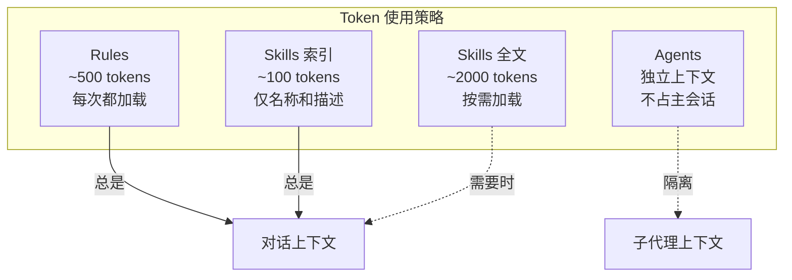
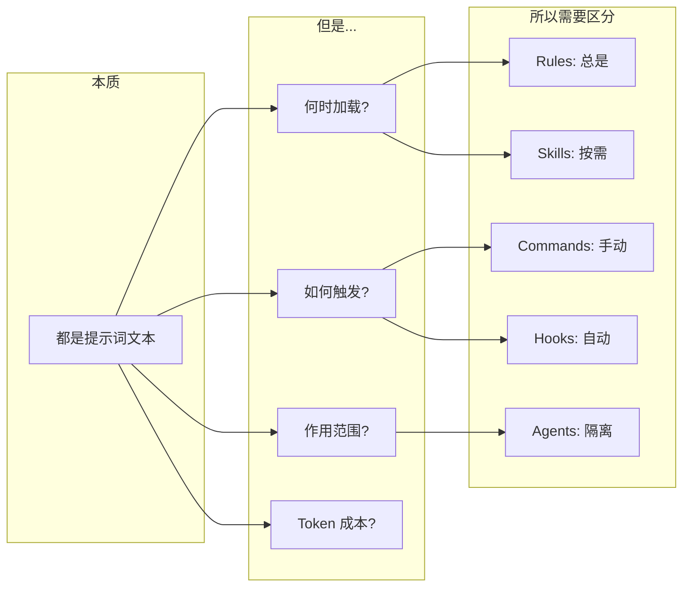
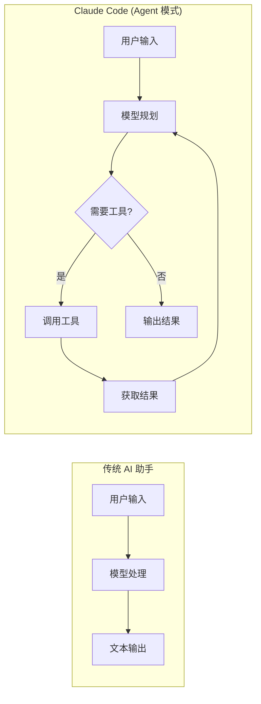
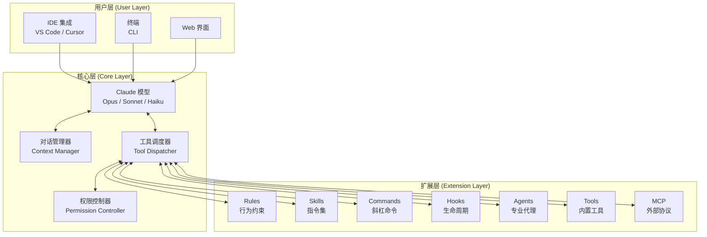
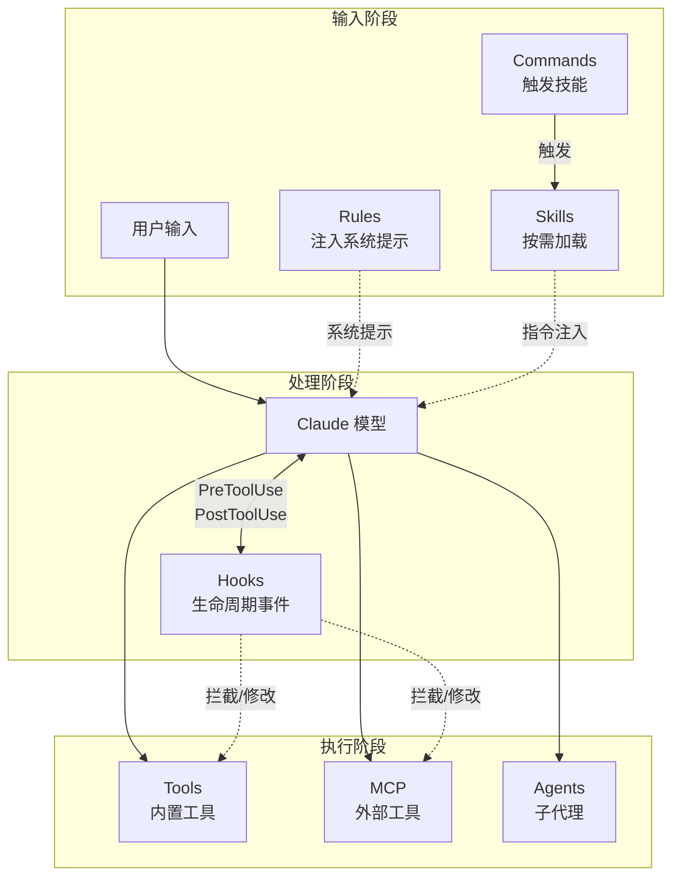
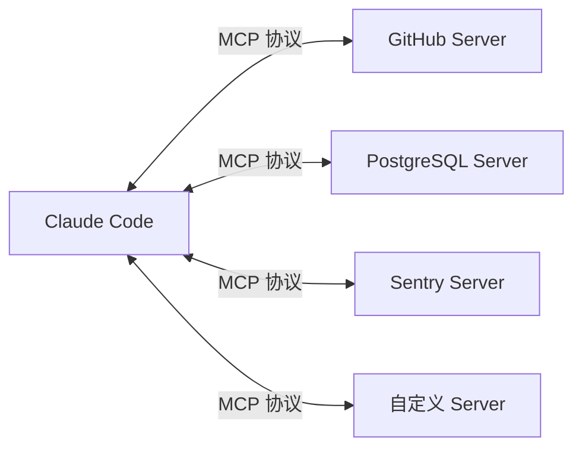
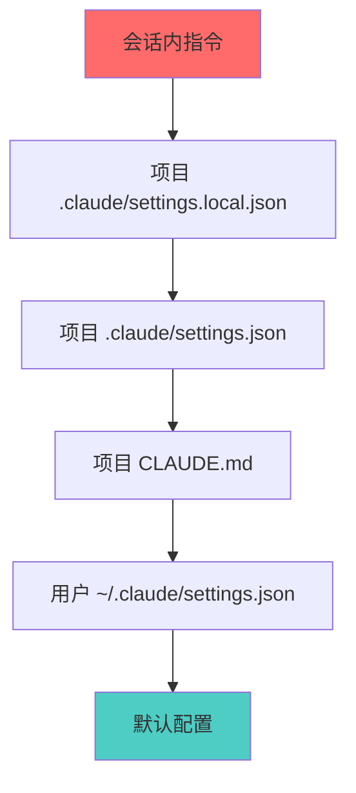
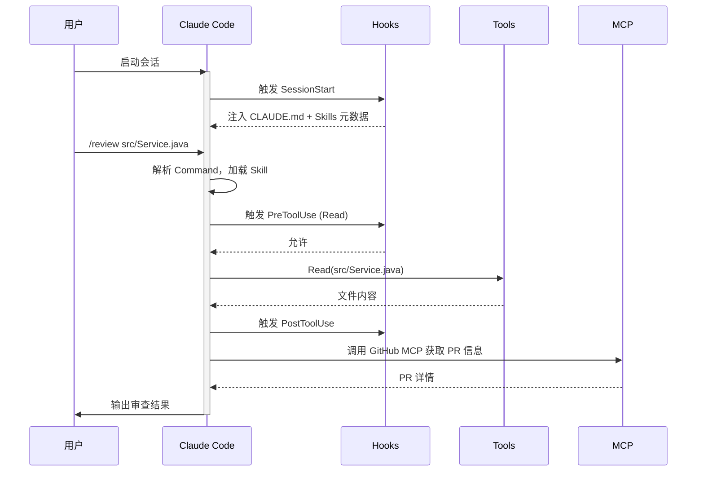

# Claude Code 架构与组件总览

> 本系列文档面向有经验的开发者，帮助你理解 Claude Code 的核心架构，掌握各组件的原理与使用方法，具备二次开发能力。

## 目录

- [架构与组件总览](/CICD-Practice/claude-code-guide/00-overview/) - 本文
- [Rules 系统](/CICD-Practice/claude-code-guide/01-rules/) - 持久化的行为约束
- [Skills 系统](/CICD-Practice/claude-code-guide/02-skills/) - 可复用的指令集
- [Commands 系统](/CICD-Practice/claude-code-guide/03-commands/) - 斜杠命令
- [Hooks 系统](/CICD-Practice/claude-code-guide/04-hooks/) - 生命周期事件
- [Agents 系统](/CICD-Practice/claude-code-guide/05-agents/) - 专业化代理
- [Tools 系统](/CICD-Practice/claude-code-guide/06-tools/) - Claude 可调用的能力
- [MCP](/CICD-Practice/claude-code-guide/07-mcp/) - Model Context Protocol

---

## 0. 先解答一个疑惑：为什么需要这么多概念？

> **"Rules、Skills、Commands、Agents 本质上不都是提示词吗？为什么要搞这么复杂？"**

从技术本质上看，**这些组件最终都会变成文本，注入到 Claude 的上下文（Context）中**。它们确实都是"提示词工程"（Prompt Engineering）的产物。

但是，这恰恰是精心设计的结果，而非过度工程。让我们用软件工程的视角来理解：

### 0.1 类比：为什么编程语言需要不同的结构？

想象一下，如果一门编程语言只有"代码"这一个概念，没有函数、类、模块、包的区分：

```
❌ 没有抽象的世界
所有代码写在一个巨大的文件里，没有函数、没有类、没有模块...
技术上可行，但维护噩梦。

✅ 有抽象的世界
- 函数：可复用的代码块
- 类：封装数据和行为
- 模块：组织相关功能
- 包：分发和共享
```

Claude Code 的组件设计遵循同样的逻辑：

| 编程概念 | Claude Code 概念 | 解决的问题 |
|----------|------------------|------------|
| 全局配置 | **Rules** | 总是生效的约束 |
| 函数库 | **Skills** | 可复用的指令集 |
| CLI 命令 | **Commands** | 快速触发入口 |
| 生命周期钩子 | **Hooks** | 自动化触发 |
| 子进程/线程 | **Agents** | 并行和隔离 |

### 0.2 核心问题：Token 经济学

LLM 的上下文窗口是 **有限且昂贵** 的资源。如果把所有指令都塞进每次对话：

```
❌ 朴素方案
每次对话 = 系统提示 + 所有规则 + 所有技能 + 所有文档 + 用户输入
结果：Token 爆炸，成本高昂，响应变慢
```

Claude Code 的分层设计解决了这个问题：



### 0.3 各组件的本质区别

虽然都是"提示词"，但它们在 **何时加载、如何触发、作用范围** 上有本质区别：

| 组件 | 加载时机 | 触发方式 | 作用范围 | Token 消耗 |
|------|----------|----------|----------|------------|
| **Rules** | 会话开始，自动加载 | 始终生效 | 全局 | 每次都消耗 |
| **Skills** | 按需加载（渐进式） | 自动匹配或手动 | 当次任务 | 需要时才消耗 |
| **Commands** | 用户输入时 | 手动 `/command` | 当次任务 | 触发时消耗 |
| **Agents** | 创建子代理时 | 由主代理调用 | 隔离上下文 | 独立计费 |
| **Hooks** | 特定事件触发 | 自动 | 事件相关 | 脚本层面 |

### 0.4 设计收益

这种分层设计带来了实际的收益：

```
1. 性能优化
   - Skills 的渐进式加载节省 70%+ 的 Token
   - Agents 的上下文隔离避免主会话膨胀

2. 可维护性
   - Rules 放全局约束，一改全改
   - Skills 按领域组织，职责清晰
   - 团队可以各自维护自己领域的 Skills

3. 可组合性
   - Skills 可以调用其他 Skills
   - Commands 可以触发 Skills
   - Hooks 可以在 Skills 执行时自动运行

4. 可移植性
   - Skills 可以跨项目共享
   - 2025 年 12 月 Skills 成为开放标准
   - 一次编写，多平台使用
```

### 0.5 一图总结



**结论**：这些概念不是为了复杂而复杂，而是为了在 **有限的上下文窗口** 中实现 **高效、可维护、可扩展** 的提示词管理。就像软件工程中的函数、类、模块一样，它们是对"提示词"这一基础单元的 **合理抽象**。

---

## 1. Claude Code 是什么

Claude Code 是 Anthropic 推出的 **AI 编程助手**，它不仅仅是一个聊天机器人，而是一个具备完整工具链的 **智能代理（Agent）系统**。

### 1.1 核心特点

| 特点 | 说明 |
|------|------|
| **代理式交互** | Claude 可以自主规划、执行多步骤任务，而不仅仅是问答 |
| **工具调用** | 可以读写文件、执行命令、搜索代码、访问网络等 |
| **上下文感知** | 自动理解项目结构、代码规范、技术栈 |
| **可扩展性** | 通过 Skills、Hooks、MCP 等机制进行深度定制 |

### 1.2 与传统 AI 助手的区别



---

## 2. 整体架构

Claude Code 的架构可以分为三层：**用户层**、**核心层**、**扩展层**。



---

## 3. 核心组件关系

下图展示了各组件之间的数据流和依赖关系：



---

## 4. 组件速览

### 4.1 Rules（规则）

**定位**：持久化的行为约束，自动注入每次对话的系统提示。

**作用**：
- 定义项目的代码规范、技术栈偏好
- 设置 Claude 的行为边界
- 提供项目特定的上下文

**文件位置**：
- `CLAUDE.md`（项目根目录）
- `.claude/rules/*.md`（模块化规则）

```markdown
# 示例：CLAUDE.md
## 技术栈
- Java 21 + Spring Boot 3.x
- Maven 构建

## 代码规范
- 使用 Lombok 简化 POJO
- 所有 API 必须有 Swagger 注解
```

→ 详见 [Rules 系统](/CICD-Practice/claude-code-guide/01-rules/)

---

### 4.2 Skills（技能）

**定位**：可复用的指令集，封装领域专业知识。

**作用**：
- 将复杂工作流打包成可调用的"技能"
- 支持渐进式加载，节省 Token
- 可跨项目共享

**文件位置**：`.claude/skills/<skill-name>/SKILL.md`

```markdown
# 示例：SKILL.md
---
name: code-review
description: 执行代码审查
---

## 审查步骤
1. 检查代码风格
2. 检查安全隐患
3. 检查性能问题
...
```

→ 详见 [Skills 系统](/CICD-Practice/claude-code-guide/02-skills/)

---

### 4.3 Commands（命令）

**定位**：斜杠命令，快速触发特定功能。

**作用**：
- 提供快捷入口（如 `/review`, `/test`）
- 与 Skills 系统深度集成
- 支持参数传递

**文件位置**：`.claude/commands/<command-name>.md`

```bash
# 使用示例
/review src/main/java/com/example/Service.java
/test --coverage
```

→ 详见 [Commands 系统](/CICD-Practice/claude-code-guide/03-commands/)

---

### 4.4 Hooks（钩子）

**定位**：生命周期事件监听器，实现自动化工作流。

**作用**：
- 在特定时机自动执行脚本
- 拦截/修改工具调用
- 注入动态上下文

**文件位置**：`.claude/hooks/hooks.json`

```json
{
  "hooks": {
    "PostToolUse": [{
      "matcher": "Write|StrReplace",
      "hooks": [{
        "type": "command",
        "command": "prettier --write $CLAUDE_FILE_PATH"
      }]
    }]
  }
}
```

→ 详见 [Hooks 系统](/CICD-Practice/claude-code-guide/04-hooks/)

---

### 4.5 Agents（代理）

**定位**：专业化的子代理，处理特定领域任务。

**作用**：
- 隔离复杂任务到独立上下文
- 并行处理多个独立问题
- 支持自定义代理配置

**文件位置**：`.claude/agents/<agent-name>.md`

```markdown
# 示例：code-reviewer.md
你是一个代码审查专家，专注于：
- 代码质量
- 安全漏洞
- 性能优化
```

→ 详见 [Agents 系统](/CICD-Practice/claude-code-guide/05-agents/)

---

### 4.6 Tools（工具）

**定位**：Claude 可以调用的内置能力。

**主要工具**：

| 工具 | 功能 |
|------|------|
| `Read` | 读取文件 |
| `Write` | 写入文件 |
| `StrReplace` | 字符串替换（编辑文件） |
| `Shell` | 执行终端命令 |
| `Grep` | 正则搜索 |
| `Glob` | 文件模式匹配 |
| `SemanticSearch` | 语义搜索 |
| `Task` | 创建子代理 |

→ 详见 [Tools 系统](/CICD-Practice/claude-code-guide/06-tools/)

---

### 4.7 MCP（Model Context Protocol）

**定位**：标准化的外部工具接入协议。

**作用**：
- 连接数据库、API、第三方服务
- 提供统一的工具发现和调用机制
- 支持本地和远程服务器



→ 详见 [MCP](/CICD-Practice/claude-code-guide/07-mcp/)

---

## 5. 配置文件结构

Claude Code 的配置分布在多个位置：

```
项目根目录/
├── CLAUDE.md                    # 项目级规则（自动加载）
└── .claude/
    ├── settings.json            # 项目设置
    ├── settings.local.json      # 本地设置（不提交）
    ├── rules/                   # 模块化规则
    │   ├── api.md
    │   └── testing.md
    ├── skills/                  # 技能目录
    │   └── <skill-name>/
    │       ├── SKILL.md
    │       └── (supporting files)
    ├── commands/                # 命令目录
    │   └── <command-name>.md
    ├── hooks/                   # 钩子配置
    │   ├── hooks.json
    │   └── (hook scripts)
    └── agents/                  # 代理配置
        └── <agent-name>.md

用户主目录/
├── ~/.claude/
│   └── settings.json            # 用户级设置
└── ~/.cursor/                   # Cursor 特定配置
    └── skills-cursor/           # Cursor 内置技能
```

---

## 6. 配置优先级

当同一配置在多处定义时，优先级如下（从高到低）：



---

## 7. 典型工作流程

以下是一个典型的 Claude Code 会话流程：



---

## 8. 下一步

根据你的学习目标选择阅读顺序：

### 快速上手路径
1. [Rules 系统](/CICD-Practice/claude-code-guide/01-rules/) - 先配置好项目规则
2. [Tools 系统](/CICD-Practice/claude-code-guide/06-tools/) - 了解 Claude 能做什么
3. [Commands 系统](/CICD-Practice/claude-code-guide/03-commands/) - 学习常用命令

### 深度定制路径
1. [Skills 系统](/CICD-Practice/claude-code-guide/02-skills/) - 封装自己的工作流
2. [Hooks 系统](/CICD-Practice/claude-code-guide/04-hooks/) - 实现自动化
3. [Agents 系统](/CICD-Practice/claude-code-guide/05-agents/) - 创建专业代理

### 扩展集成路径
1. [MCP](/CICD-Practice/claude-code-guide/07-mcp/) - 连接外部服务
2. [Tools 系统](/CICD-Practice/claude-code-guide/06-tools/) - 理解工具机制

---

## 参考资源

- [Claude Code 官方文档](https://docs.anthropic.com/en/docs/claude-code)
- [MCP 协议规范](https://modelcontextprotocol.io/)
- [Anthropic 工程博客 - Agent Skills](https://anthropic.com/engineering/equipping-agents-for-the-real-world-with-agent-skills)
