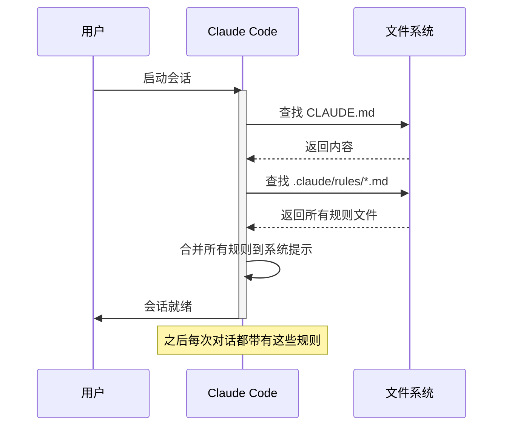
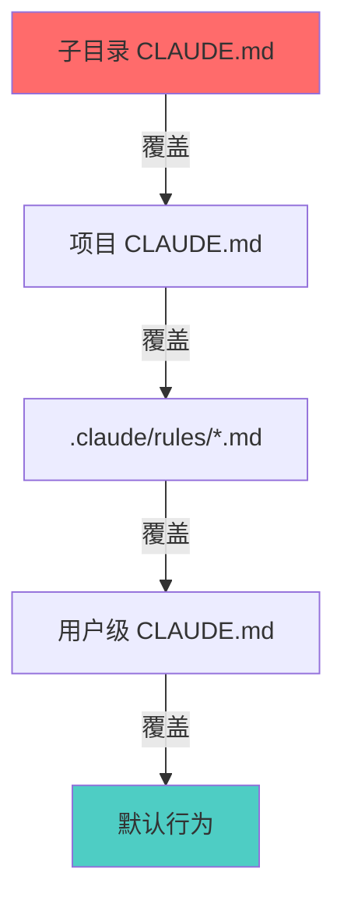

# Rules 系统：持久化的行为约束

> Rules 是 Claude Code 最基础也最重要的配置机制。通过 Rules，你可以定义项目的"宪法"——Claude 在每次对话中都会遵循的行为准则。

---

## 1. 概述

### 1.1 什么是 Rules

Rules（规则）是一组**持久化的指令**，它们会被自动注入到每次对话的系统提示（System Prompt）中，让 Claude 在整个会话期间始终遵循这些约束。

### 1.2 Rules 的作用

| 场景 | 没有 Rules | 有 Rules |
|------|-----------|----------|
| 每次对话 | 需要重复说明技术栈、规范 | Claude 自动了解项目背景 |
| 代码风格 | 可能生成不符合规范的代码 | 始终遵循团队约定 |
| 错误处理 | 可能忽略项目特有的坑 | 会主动避开已知问题 |

### 1.3 Rules vs Skills

```mermaid
graph LR
    subgraph Rules
        R1[始终生效]
        R2[注入系统提示]
        R3[定义"是什么"]
    end
    
    subgraph Skills
        S1[按需加载]
        S2[用户或模型触发]
        S3[定义"怎么做"]
    end
    
    R1 -.->|区别| S1
    R2 -.->|区别| S2
    R3 -.->|区别| S3
```

**简单理解**：
- **Rules** = 项目的"身份证"（Claude 必须知道的背景信息）
- **Skills** = 项目的"工具箱"（Claude 可以使用的专业技能）

---

## 2. 核心概念

### 2.1 Rules 的加载机制



### 2.2 文件位置与优先级

Claude Code 会在以下位置查找 Rules（按优先级从高到低）：

| 位置 | 文件 | 作用范围 | 优先级 |
|------|------|----------|--------|
| 当前目录 | `CLAUDE.md` | 子目录特定 | 最高 |
| 项目根目录 | `CLAUDE.md` | 整个项目 | 高 |
| 项目根目录 | `.claude/rules/*.md` | 模块化规则 | 中 |
| 用户主目录 | `~/.claude/CLAUDE.md` | 所有项目 | 低 |

### 2.3 路径匹配规则

`.claude/rules/` 目录下的规则文件支持**路径匹配**，让规则只对特定文件生效：

~~~markdown
---
# .claude/rules/api.md
globs:
  - "src/main/java/**/controller/**"
  - "src/main/java/**/api/**"
---

## API 开发规范
- 所有接口必须添加 @Operation 注解
- 返回值统一使用 Result<T> 包装
~~~

**匹配规则**：
- `*` - 匹配单层目录中的任意字符
- `**` - 匹配任意层级目录
- `*.java` - 匹配所有 Java 文件

---

## 3. CLAUDE.md 详解

### 3.1 基本结构

一个完整的 `CLAUDE.md` 应包含以下部分：

~~~markdown
# CLAUDE.md

## 项目概述
[项目是什么，解决什么问题]

## 技术栈
[使用的语言、框架、工具及版本]

## 项目结构
[关键目录的作用说明]

## 代码规范
[命名、格式、注释等约定]

## 构建与运行
[常用命令]

## 注意事项
[坑、特殊情况、禁忌]
~~~

### 3.2 完整示例

以下是一个 Spring Boot 项目的 `CLAUDE.md` 示例：

~~~markdown
# CLAUDE.md

## 项目概述

这是 **蚂蚁链文件传输服务**（antcloud-upload），一个 Spring Boot 应用，负责：
- 定时调度文件上传任务到蚂蚁链
- 从 api-manager 服务下载文件
- 多线程上传处理
- 上传记录状态追踪

## 技术栈

| 类型 | 技术 | 版本 |
|------|------|------|
| 语言 | Java | 21 |
| 框架 | Spring Boot | 3.x |
| 构建 | Maven | 3.9+ |
| 容器化 | Docker | - |
| 编排 | Kubernetes | - |

## 项目结构
```txt
src/main/java/com/cprt/antcloud/
├── controller/      # REST 控制器
├── service/         # 业务逻辑
├── schedule/        # 定时任务
├── config/          # 配置类
```

## 代码规范

### 命名约定
- 类名：大驼峰，如 `FileUploadService`
- 方法名：小驼峰，如 `uploadFile`
- 常量：全大写下划线，如 `MAX_RETRY_COUNT`

### 注解使用
- 所有 Controller 方法必须有 `@Operation` 注解
- Service 类使用 `@Slf4j` 而非手动创建 Logger
- 配置属性类使用 `@ConfigurationProperties`

### 异常处理
- 业务异常抛出 `BusinessException`
- 不要吞掉异常，至少要记录日志

## 构建与运行


# 本地运行
mvn spring-boot:run

# 打包（跳过测试）
mvn clean package -Pprod -Dmaven.test.skip=true

# 运行测试
mvn test


## 注意事项

### 敏感信息
- `application.yml` 中的 accessKey/secretKey 不要提交到代码库
- 使用环境变量或配置中心管理敏感配置

### 已知问题
- 上传超时阈值设为 12 小时，超时后标记为失败
- 临时文件路径由 `tempFilePath` 配置，确保目录存在且有写权限
~~~

### 3.3 编写原则

| 原则 | 说明 | 示例 |
|------|------|------|
| **具体** | 避免模糊描述 | ❌ "代码要规范" → ✅ "方法不超过 50 行" |
| **可执行** | Claude 能据此行动 | ❌ "注意性能" → ✅ "N+1 查询必须用 @BatchSize 解决" |
| **有示例** | 展示而非仅告知 | ❌ "用 Result 包装" → ✅ "返回 `Result.ok(data)`" |
| **保持更新** | 定期同步实际情况 | 添加新技术时更新技术栈部分 |

---

## 4. 模块化规则（.claude/rules/）

### 4.1 为什么需要模块化

当项目变大时，单个 `CLAUDE.md` 会变得臃肿。模块化规则让你可以：
- **按职责拆分**：API 规范、测试规范、安全规范各自独立
- **按路径生效**：前端规则只在前端目录生效
- **便于维护**：修改一个规则不影响其他

### 4.2 目录结构
```
.claude/
└── rules/
    ├── api.md           # API 开发规范
    ├── testing.md       # 测试规范
    ├── security.md      # 安全规范
    └── frontend.md      # 前端规范
```

### 4.3 规则文件格式

```markdown
---
# YAML Frontmatter（可选）
globs:
  - "**/*.java"
description: "Java 代码规范"
alwaysApply: false
---

# Java 代码规范

## 这部分内容会在匹配的文件上下文中注入
...
```

**Frontmatter 字段**：

| 字段 | 类型 | 说明 |
|------|------|------|
| `globs` | string[] | 路径匹配模式，不设则全局生效 |
| `description` | string | 规则描述，用于 Claude 判断相关性 |
| `alwaysApply` | boolean | 是否始终应用（即使路径不匹配） |

### 4.4 实际示例

**`.claude/rules/api.md`**：
~~~markdown
---
globs:
  - "src/main/java/**/controller/**"
  - "src/main/java/**/rest/**"
description: "REST API 开发规范"
---

# REST API 开发规范

## 接口设计
- URL 使用 kebab-case：`/user-profiles` 而非 `/userProfiles`
- 使用 HTTP 动词表达操作：GET 查询、POST 创建、PUT 更新、DELETE 删除
- 分页参数统一使用 `page`（从 0 开始）和 `size`

## 响应格式
所有接口返回统一格式：
```java
@GetMapping("/{id}")
public Result<UserDTO> getUser(@PathVariable Long id) {
    return Result.ok(userService.findById(id));
}
```

## 错误处理
- 业务错误返回 200 + 错误码，不使用 HTTP 4xx
- 系统错误由全局异常处理器统一处理
~~~

**`.claude/rules/testing.md`**：
~~~markdown
---
globs:
  - "src/test/**"
description: "测试代码规范"
---

# 测试规范

## 命名
- 测试类：`被测类名 + Test`，如 `UserServiceTest`
- 测试方法：`should_期望行为_when_条件`

## 结构
使用 Given-When-Then 模式：
```java
@Test
void should_return_user_when_id_exists() {
    // Given
    User user = createTestUser();
    when(userRepository.findById(1L)).thenReturn(Optional.of(user));
    
    // When
    UserDTO result = userService.findById(1L);
    
    // Then
    assertThat(result.getName()).isEqualTo("test");
}
```

## 覆盖率
- Service 层覆盖率 > 80%
- Controller 层需要集成测试
~~~

---

## 5. 配置优先级详解

### 5.1 合并策略

当多个 Rules 定义了相同方面的规则时，Claude 会按以下策略处理：



### 5.2 冲突处理

如果规则冲突，**更具体的规则优先**：

~~~markdown
# 项目 CLAUDE.md
使用 4 空格缩进

# .claude/rules/frontend.md (globs: ["*.vue", "*.ts"])
使用 2 空格缩进
~~~

在编辑 `.vue` 文件时，Claude 会使用 2 空格缩进。

---

## 6. 实战案例：从零配置一个项目

### 6.1 场景

你刚接手一个 Spring Boot + Vue 的全栈项目，需要配置 Rules。

### 6.2 步骤

**Step 1：创建项目根目录 CLAUDE.md**

~~~markdown
# CLAUDE.md

## 项目概述
订单管理系统，包含后端 API 和前端界面。

## 技术栈
- 后端：Java 17, Spring Boot 2.7, MyBatis Plus
- 前端：Vue 3, TypeScript, Element Plus
- 数据库：MySQL 8.0

## Monorepo 结构
```
├── backend/     # Spring Boot 后端
├── frontend/    # Vue 前端
└── docs/        # 文档
```
~~~

**Step 2：创建后端规则**

```bash
mkdir -p .claude/rules
```

`.claude/rules/backend.md`：
~~~markdown
---
globs:
  - "backend/**/*.java"
description: "后端 Java 开发规范"
---

# 后端开发规范

## 分层架构
- Controller：只做参数校验和结果包装
- Service：业务逻辑
- Mapper：数据访问（MyBatis Plus）

## 事务管理
- Service 方法需要事务时加 `@Transactional`
- 只读操作加 `@Transactional(readOnly = true)`
~~~

**Step 3：创建前端规则**

`.claude/rules/frontend.md`：
~~~markdown
---
globs:
  - "frontend/**/*.vue"
  - "frontend/**/*.ts"
description: "前端 Vue/TypeScript 开发规范"
---

# 前端开发规范

## 组件规范
- 使用 Composition API + `<script setup>`
- Props 使用 `defineProps` 并声明类型

## 命名
- 组件文件：PascalCase，如 `UserProfile.vue`
- 组合函数：以 `use` 开头，如 `useUserList.ts`
~~~

**Step 4：验证配置**

启动 Claude Code，检查是否正确加载了规则：

```
> 这个项目使用什么技术栈？
```

Claude 应该能回答出 Java 17、Spring Boot 2.7、Vue 3 等信息。

---

## 7. 最佳实践

### 7.1 应该放入 Rules 的内容

✅ **推荐**：
- 技术栈和版本信息
- 代码规范和约定
- 项目结构说明
- 常用命令
- 已知问题和解决方案
- 安全相关的禁忌

### 7.2 不应该放入 Rules 的内容

❌ **避免**：
- 敏感信息（密钥、密码）
- 频繁变化的内容
- 过于细节的实现逻辑
- 与当前项目无关的通用知识

### 7.3 维护建议

| 频率 | 动作 |
|------|------|
| 每次提交 | 检查是否需要更新 Rules |
| 每周 | 审视 Rules 是否与实际一致 |
| 技术栈变更时 | 立即更新相关版本信息 |

---

## 8. 常见问题

### Q1：CLAUDE.md 不生效？

**检查**：
1. 文件名是否正确（区分大小写）
2. 文件是否在项目根目录
3. 文件内容是否有语法错误

### Q2：规则太多导致上下文过长？

**解决**：
1. 使用 `.claude/rules/` 模块化，配合 `globs` 限制作用范围
2. 移除不必要的详细说明
3. 将"怎么做"的内容移到 Skills

### Q3：多人协作时 Rules 冲突？

**建议**：
1. 在团队内讨论并统一规范
2. 使用 `.claude/rules/` 按职责拆分，减少冲突
3. 将 Rules 纳入 Code Review 范围

### Q4：如何调试 Rules 是否生效？

```
> 请列出你目前了解的项目规范
```

Claude 会输出它理解的规则，你可以据此判断哪些生效了。

---

## 9. 进阶话题

### 9.1 动态规则（结合 Hooks）

可以通过 Hooks 在会话启动时动态注入规则：

```json
// .claude/hooks/hooks.json
{
  "hooks": {
    "SessionStart": [{
      "matcher": "",
      "hooks": [{
        "type": "command",
        "command": "./scripts/generate-rules.sh"
      }]
    }]
  }
}
```

`generate-rules.sh` 可以根据当前分支、环境等动态生成规则内容。

### 9.2 Rules 与 Skills 的配合

Rules 定义"是什么"，Skills 定义"怎么做"：

~~~markdown
# CLAUDE.md (Rules)
## 测试规范
- 所有 Service 方法必须有单元测试
- 使用 JUnit 5 + Mockito

# .claude/skills/test-generator/SKILL.md (Skills)
## 生成单元测试
1. 读取目标类
2. 分析公开方法
3. 为每个方法生成测试用例
...
~~~

---

## 下一篇

了解了 Rules 后，继续学习 [Skills 系统](/CICD-Practice/claude-code-guide/02-skills/)，掌握如何封装可复用的工作流。
