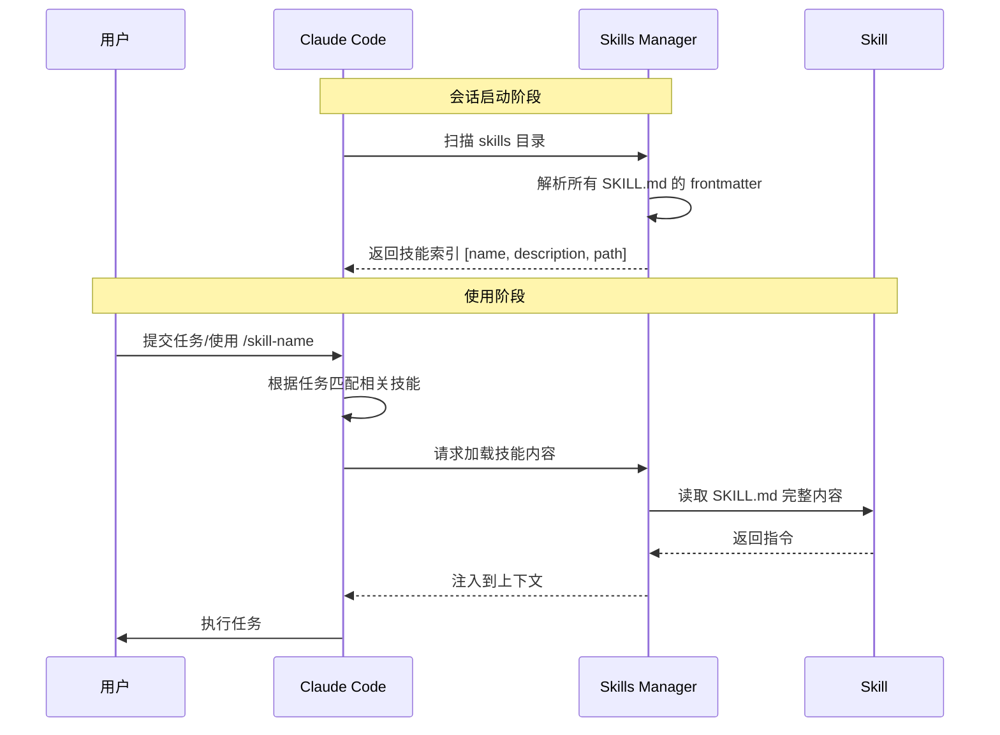
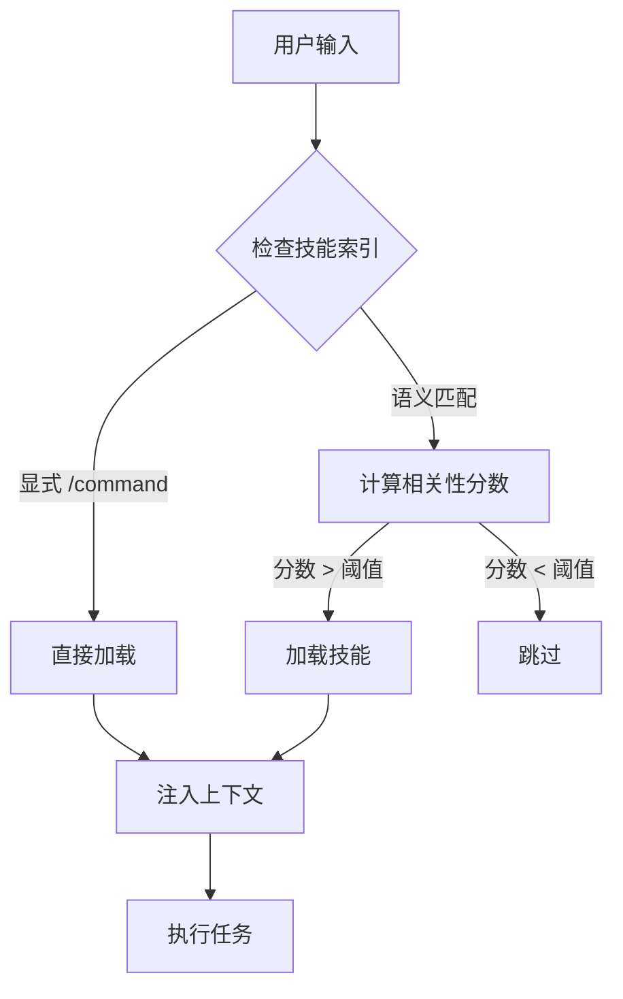
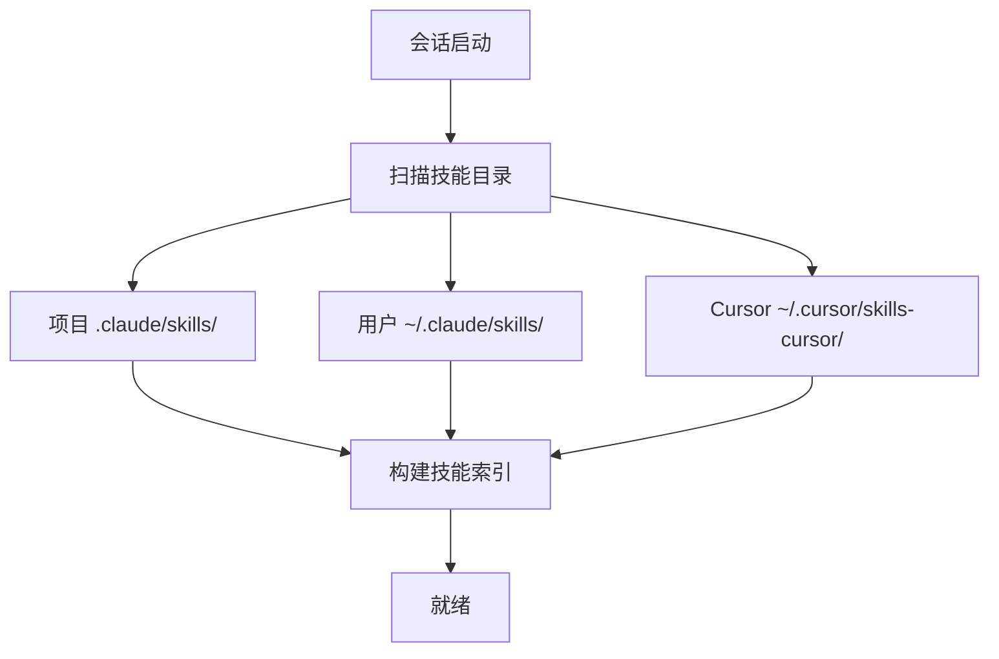
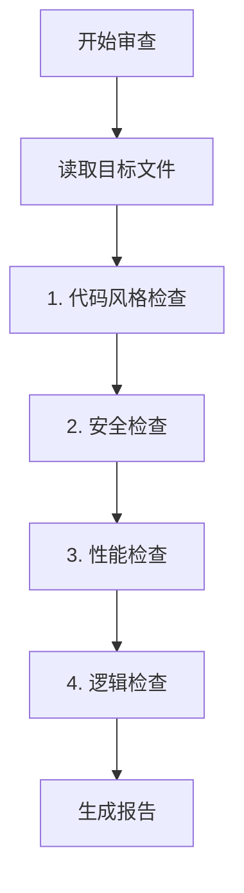
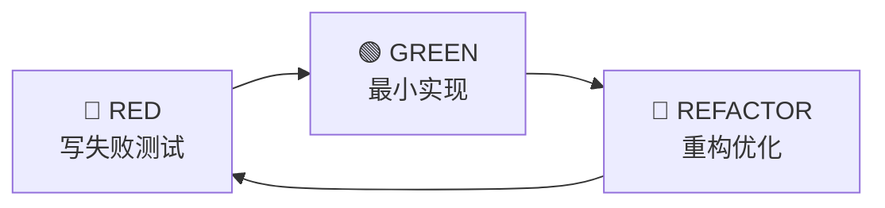
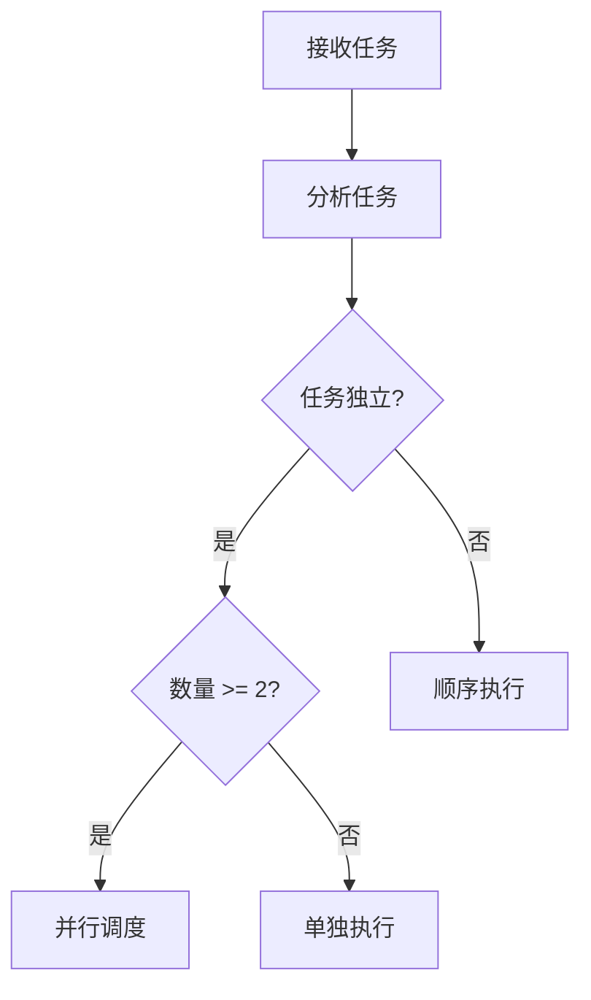

# Skills 系统：可复用的指令集

> Skills 是 Claude Code 最强大的扩展机制，它允许你将领域专业知识封装成可复用、可组合的"技能包"。

## 目录

1. [什么是 Skills](#1-什么是-skills)
2. [核心原理](#2-核心原理)
3. [目录结构](#3-目录结构)
4. [SKILL.md 详解](#4-skillmd-详解)
5. [技能发现与加载](#5-技能发现与加载)
6. [高级特性](#6-高级特性)
7. [实战案例](#7-实战案例)
8. [最佳实践](#8-最佳实践)
9. [常见问题](#9-常见问题)

---

## 1. 什么是 Skills

### 1.1 定义

Skills（技能）是 **组织化的指令文件夹**，包含 `SKILL.md` 主文件和可选的支持文件（脚本、模板、示例等）。它让 Claude 能够执行特定领域的专业任务。

### 1.2 与其他组件的区别

| 组件 | 作用 | 加载时机 | 典型大小 |
|------|------|----------|----------|
| **Rules** | 定义行为边界 | 每次会话开始自动加载 | 小（< 1KB） |
| **Skills** | 封装专业知识 | 按需加载（渐进式） | 大（1-10KB+） |
| **Commands** | 触发入口 | 用户输入时 | 小 |

### 1.3 设计哲学

Skills 的设计遵循 **渐进式披露（Progressive Disclosure）** 原则：


- **第一层**：仅加载名称和描述（几十字节）
- **第二层**：匹配后加载完整 SKILL.md（几 KB）
- **第三层**：按需加载支持文件（脚本、模板等）

这种设计让 Claude 能"知道"数百个技能的存在，但只在需要时才消耗 Token。

---

## 2. 核心原理

### 2.1 技能生命周期



### 2.2 匹配机制

Claude 通过以下方式判断是否需要某个技能：

1. **显式调用**：用户使用 `/skill-name` 命令
2. **自动匹配**：任务描述与技能的 `description` 语义相关
3. **规则触发**：其他技能或规则中引用



---

## 3. 目录结构

### 3.1 基本结构

```
.claude/skills/
├── my-skill/
│   ├── SKILL.md           # 必需：主技能文件
│   ├── template.md        # 可选：模板文件
│   ├── examples/          # 可选：示例目录
│   │   ├── example1.ts
│   │   └── example2.ts
│   └── scripts/           # 可选：辅助脚本
│       └── validate.sh
└── another-skill/
    └── SKILL.md
```

### 3.2 文件说明

| 文件 | 必需 | 说明 |
|------|------|------|
| `SKILL.md` | ✅ | 技能的主要指令文件 |
| `*.md` | ❌ | 额外的文档/模板 |
| `*.sh / *.js / *.py` | ❌ | 辅助脚本 |
| `examples/` | ❌ | 示例代码/配置 |

### 3.3 技能位置

技能可以存放在多个位置：

| 位置 | 作用域 | 示例路径 |
|------|--------|----------|
| 项目级 | 当前项目 | `.claude/skills/` |
| 用户级 | 所有项目 | `~/.claude/skills/` |
| Cursor 内置 | Cursor 用户 | `~/.cursor/skills-cursor/` |

---

## 4. SKILL.md 详解

### 4.1 基本格式

```markdown
---
name: my-skill
description: 一句话描述这个技能做什么
---

# 技能标题

## 使用场景
描述何时应该使用这个技能...

## 执行步骤
1. 第一步
2. 第二步
...

## 注意事项
- 注意点 1
- 注意点 2
```

### 4.2 Frontmatter 字段

Frontmatter 是 SKILL.md 开头的 YAML 元数据块：

```yaml
---
name: code-review              # 必需：技能名称（用于 /command）
description: 执行代码审查      # 必需：简短描述（用于匹配）
invocation: user               # 可选：调用方式
tools: [Read, Grep, Shell]     # 可选：允许使用的工具
---
```

#### 字段详解

| 字段 | 类型 | 默认值 | 说明 |
|------|------|--------|------|
| `name` | string | 目录名 | 技能唯一标识，用于 `/name` 调用 |
| `description` | string | - | 用于自动匹配的描述文本 |
| `invocation` | string | `auto` | 调用方式：`user`（仅用户）、`auto`（自动）、`claude`（仅 Claude） |
| `tools` | string[] | 全部 | 限制可使用的工具列表 |
| `agents` | string[] | - | 允许使用的子代理 |

### 4.3 指令编写原则

**好的指令**应该是：

~~~markdown
## ✅ 好的示例

### 审查步骤

1. **检查代码风格**
   - 运行 `Grep` 搜索 TODO/FIXME 注释
   - 检查命名是否符合项目规范

2. **检查安全问题**
   - 搜索硬编码的密钥/密码
   - 检查 SQL 注入风险

3. **输出格式**
   使用以下格式输出审查结果：
   ```
   ## 审查结果
   - 严重问题: X 个
   - 警告: Y 个
   - 建议: Z 个
   ```
~~~

**避免的写法**：

```markdown
## ❌ 不好的示例

帮我审查代码，找出问题。

（太模糊，没有具体步骤）
```

### 4.4 引用支持文件

在 SKILL.md 中可以引用同目录下的其他文件：

```markdown
## 模板

代码审查报告请使用 [review-template.md](./review-template.md) 模板格式。

## 示例

参考 [examples/good-review.md](./examples/good-review.md) 了解输出格式。
```

Claude 会在需要时自动读取这些文件。

---

## 5. 技能发现与加载

### 5.1 自动发现

Claude Code 在会话开始时自动扫描以下位置：



### 5.2 手动触发

```bash
# 方式 1：斜杠命令（推荐）
/code-review src/main/java/Service.java

# 方式 2：自然语言
"使用 code-review 技能审查这个文件"

# 方式 3：明确请求
"请加载并使用代码审查技能"
```

### 5.3 查看已加载的技能

可以在对话中询问：

```
"你当前加载了哪些技能？"
"列出可用的技能"
```

---

## 6. 高级特性

### 6.1 参数传递

技能可以接收参数：

```bash
/deploy production --skip-tests
```

在 SKILL.md 中通过 `$1`, `$2` 或命名参数访问：

```markdown
## 部署步骤

1. 目标环境: $1 (production/staging/dev)
2. 选项: $2 (--skip-tests 等)
```

### 6.2 技能组合

一个技能可以调用其他技能：

```markdown
## 完整发布流程

1. 首先执行 `/code-review` 技能
2. 如果审查通过，执行 `/test` 技能
3. 测试通过后，执行 `/deploy` 技能
```

### 6.3 条件逻辑

```markdown
## 执行条件

### 如果是 Java 项目
- 使用 Maven 构建
- 运行 JUnit 测试

### 如果是 Node.js 项目
- 使用 npm 构建
- 运行 Jest 测试
```

### 6.4 工具限制

通过 frontmatter 限制技能可用的工具：

```yaml
---
name: safe-review
description: 只读的代码审查
tools: [Read, Grep, Glob, SemanticSearch]  # 不包含 Write, Shell 等
---
```

这对于创建"安全"的审查类技能很有用。

### 6.5 动态上下文注入

使用 Hooks 在技能加载时注入动态信息hooks.json：

```json
{
  "hooks": {
    "UserPromptSubmit": [{
      "matcher": "/deploy",
      "hooks": [{
        "type": "command",
        "command": "echo \"当前 Git 分支: $(git branch --show-current)\""
      }]
    }]
  }
}
```

---

## 7. 实战案例

### 7.1 案例：代码审查技能

**目录结构**：

```
.claude/skills/code-review/
├── SKILL.md
├── checklist.md
└── examples/
    └── sample-review.md
```

**SKILL.md**：

~~~markdown
---
name: code-review
description: 执行全面的代码审查，检查质量、安全、性能问题
tools: [Read, Grep, Glob, SemanticSearch]
---

# 代码审查技能

## 触发条件

当用户请求代码审查、review、检查代码质量时使用此技能。

## 审查流程



### 1. 代码风格检查

使用 `Grep` 检查以下问题：
- TODO/FIXME 注释: `grep -n "TODO\|FIXME"`
- 魔法数字: 硬编码的数值常量
- 过长的方法（> 50 行）
- 命名规范违规

### 2. 安全检查

重点关注：
- 硬编码的密钥/密码: `grep -i "password\|secret\|key\|token"`
- SQL 拼接（注入风险）
- 不安全的反序列化
- 日志中的敏感信息

### 3. 性能检查

- N+1 查询问题
- 循环中的数据库调用
- 不必要的对象创建
- 缺少索引的查询

### 4. 逻辑检查

- 空指针风险
- 异常处理是否完整
- 边界条件
- 并发安全

## 输出格式

使用 [checklist.md](./checklist.md) 中的模板格式输出。

严重程度分级：
- 🔴 **严重**：必须修复
- 🟡 **警告**：建议修复
- 🔵 **建议**：可以改进

## 示例输出

参考 [examples/sample-review.md](./examples/sample-review.md)
~~~

**checklist.md**：

```markdown
# 代码审查报告

## 基本信息
- 文件: {filename}
- 审查时间: {datetime}
- 审查范围: {scope}

## 审查结果汇总

| 类别 | 严重 | 警告 | 建议 |
|------|------|------|------|
| 代码风格 | 0 | 0 | 0 |
| 安全问题 | 0 | 0 | 0 |
| 性能问题 | 0 | 0 | 0 |
| 逻辑问题 | 0 | 0 | 0 |

## 详细问题

### 🔴 严重问题

(列出严重问题...)

### 🟡 警告

(列出警告...)

### 🔵 建议

(列出建议...)

## 改进建议

(总体改进建议...)
```

---

### 7.2 案例：TDD 开发技能

~~~markdown
---
name: tdd
description: 测试驱动开发流程，先写测试再实现
---

# 测试驱动开发 (TDD)

## 核心原则



## 强制规则

1. **必须先看到测试失败**
   - 写测试后立即运行
   - 确认测试因为正确的原因失败
   - 禁止跳过这一步

2. **最小实现**
   - 只写让测试通过的最少代码
   - 不要提前优化
   - 不要添加未测试的功能

3. **重构时机**
   - 测试通过后才能重构
   - 重构不改变行为，只改善结构
   - 每次重构后运行测试

## 执行步骤

### Step 1: 理解需求
- 明确要实现的功能
- 拆分为可测试的小单元

### Step 2: 写测试 (RED)
```bash
# 创建测试文件
# 编写测试用例
# 运行测试，确认失败
mvn test -Dtest=XxxTest
```

### Step 3: 实现 (GREEN)
```bash
# 写最小实现
# 运行测试，确认通过
mvn test -Dtest=XxxTest
```

### Step 4: 重构 (REFACTOR)
```bash
# 优化代码结构
# 运行全部测试，确认没有破坏
mvn test
```

### Step 5: 循环
重复 Step 2-4 直到功能完成。

## 禁止行为

- ❌ 先写实现再补测试
- ❌ 跳过失败测试直接实现
- ❌ 一次写多个测试
- ❌ 在测试失败时重构
~~~

---

### 7.3 案例：并行代理调度技能

这是你项目中已有的技能，展示了如何处理复杂的工作流：

~~~markdown
---
name: dispatching-parallel-agents
description: 当面对多个独立任务时，并行调度多个代理处理
---

# 并行代理调度

## 使用场景

当遇到以下情况时使用此技能：
- 多个独立的问题需要解决
- 问题之间没有依赖关系
- 顺序处理会浪费时间

## 决策流程



## 执行步骤

1. **识别独立任务**
   - 分析用户请求
   - 识别可以独立完成的子任务

2. **创建代理**
   - 为每个任务创建专门的子代理
   - 明确每个代理的职责边界

3. **并行执行**
   - 同时启动所有代理
   - 监控执行状态

4. **汇总结果**
   - 收集各代理结果
   - 合并输出
~~~

---

## 8. 最佳实践

### 8.1 技能设计原则

| 原则 | 说明 | 示例 |
|------|------|------|
| **单一职责** | 每个技能只做一件事 | `code-review` 不应该包含部署逻辑 |
| **自包含** | 技能应该包含所有必要信息 | 不依赖外部未声明的知识 |
| **可测试** | 技能行为应该可预测 | 相同输入产生相同输出 |
| **渐进式** | 利用支持文件分层加载 | 主文件简洁，详情放支持文件 |

### 8.2 命名规范

```
✅ 好的命名
- code-review
- deploy-production
- generate-api-docs

❌ 不好的命名
- skill1
- my-skill
- do-stuff
```

### 8.3 文档规范

```markdown
# 技能标题

## 简介
一两句话说明技能用途。

## 使用场景
明确何时应该使用这个技能。

## 前置条件
列出使用前需要满足的条件。

## 执行步骤
详细的分步骤指令。

## 输出格式
说明期望的输出格式。

## 示例
提供具体的使用示例。

## 注意事项
列出重要的注意点和限制。
```

### 8.4 调试技巧

1. **检查技能是否被识别**
   ```
   "列出当前可用的技能"
   ```

2. **查看技能内容**
   ```
   "显示 code-review 技能的完整内容"
   ```

3. **测试技能匹配**
   ```
   "如果我说'帮我检查代码质量'，你会使用哪个技能？"
   ```

---

## 9. 常见问题

### Q: 技能没有被自动识别怎么办？

**A**: 检查以下几点：
1. `SKILL.md` 文件名是否正确（区分大小写）
2. Frontmatter 格式是否正确（必须有 `---` 分隔）
3. `description` 是否包含相关关键词
4. 文件位置是否在正确的 skills 目录下

### Q: 技能加载太慢怎么办？

**A**: 
1. 精简 SKILL.md 内容，将详细信息移到支持文件
2. 优化 `description` 使匹配更精确
3. 使用 `invocation: user` 禁止自动加载

### Q: 如何限制技能只能被特定用户使用？

**A**: 目前 Skills 系统不支持用户级权限控制。可以通过以下方式变通：
1. 将技能放在 `settings.local.json` 管理的目录
2. 使用 `.gitignore` 排除敏感技能
3. 在技能中加入手动确认步骤

### Q: 技能可以访问网络吗？

**A**: 技能本身是指令文本，不能直接访问网络。但可以：
1. 指导 Claude 使用 `WebSearch` 工具
2. 通过 MCP 连接外部服务
3. 使用 Shell 执行网络命令（如 curl）

### Q: 如何在团队中共享技能？

**A**: 
1. 将 `.claude/skills/` 目录提交到 Git 仓库
2. 创建独立的技能仓库，使用 Git submodule 引用
3. 使用符号链接指向共享位置

---

## 下一步

- [Commands 系统](/CICD-Practice/claude-code-guide/03-commands/) - 学习如何创建斜杠命令
- [Hooks 系统](/CICD-Practice/claude-code-guide/04-hooks/) - 了解如何在技能执行时触发自动化
- [Agents 系统](/CICD-Practice/claude-code-guide/05-agents/) - 探索如何在技能中使用子代理
