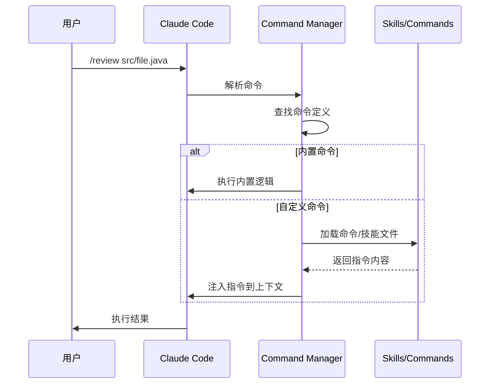

# Commands 系统：斜杠命令

> Commands（命令）是 Claude Code 的快捷入口，通过简单的 `/command` 语法快速触发特定功能。

## 目录

1. [什么是 Commands](#1-什么是-commands)
2. [内置命令](#2-内置命令)
3. [自定义命令](#3-自定义命令)
4. [Commands 与 Skills 的关系](#4-commands-与-skills-的关系)
5. [高级用法](#5-高级用法)
6. [实战案例](#6-实战案例)
7. [最佳实践](#7-最佳实践)
8. [常见问题](#8-常见问题)

---

## 1. 什么是 Commands

### 1.1 定义

Commands 是以 `/` 开头的快捷指令，类似于 Slack 或 Discord 的斜杠命令。它们提供了一种快速、可预测的方式来触发 Claude Code 的特定功能。

### 1.2 命令类型

```mermaid
graph TB
    Commands[Commands 命令系统]
    Commands --> Built[内置命令]
    Commands --> Custom[自定义命令]
    
    Built --> Config[/config - 配置]
    Built --> Init[/init - 初始化]
    Built --> Help[/help - 帮助]
    Built --> Clear[/clear - 清除]
    
    Custom --> Legacy[.claude/commands/*.md<br/>传统方式]
    Custom --> Skills[.claude/skills/*/SKILL.md<br/>技能方式]
```

### 1.3 命令执行流程



---

## 2. 内置命令

Claude Code 提供了一系列内置命令：

### 2.1 核心命令列表

| 命令 | 功能 | 示例 |
|------|------|------|
| `/help` | 显示帮助信息 | `/help` |
| `/config` | 打开配置界面 | `/config` |
| `/init` | 初始化 CLAUDE.md | `/init` |
| `/clear` | 清除对话历史 | `/clear` |
| `/compact` | 压缩上下文 | `/compact` |
| `/cost` | 显示 Token 使用情况 | `/cost` |
| `/doctor` | 诊断问题 | `/doctor` |
| `/login` | 登录账户 | `/login` |
| `/logout` | 登出账户 | `/logout` |
| `/model` | 切换模型 | `/model sonnet` |
| `/permissions` | 管理权限 | `/permissions` |
| `/status` | 显示状态 | `/status` |
| `/memory` | 管理记忆 | `/memory` |
| `/review` | 代码审查 | `/review file.js` |
| `/terminal-setup` | 终端设置 | `/terminal-setup` |

### 2.2 命令详解

#### `/init` - 初始化项目

```bash
/init
```

自动分析项目结构，生成 `CLAUDE.md` 配置文件：
- 检测技术栈（语言、框架）
- 识别构建工具
- 发现目录结构
- 生成基础规则

#### `/config` - 配置管理

```bash
/config
```

打开配置界面，可以管理：
- API 密钥
- 模型选择
- 权限设置
- MCP 服务器

#### `/compact` - 上下文压缩

```bash
/compact
```

当对话变长、Token 使用过多时：
- 总结历史对话
- 保留关键信息
- 释放上下文空间

#### `/model` - 模型切换

```bash
/model opus    # 切换到 Opus（最强）
/model sonnet  # 切换到 Sonnet（平衡）
/model haiku   # 切换到 Haiku（最快）
```

---

## 3. 自定义命令

### 3.1 传统方式：commands 目录

在 `.claude/commands/` 目录下创建 Markdown 文件：

```
.claude/commands/
├── review.md
├── test.md
└── deploy.md
```

**文件格式**：

~~~markdown
# review.md

执行代码审查：

1. 读取指定文件
2. 检查代码风格
3. 查找潜在问题
4. 输出审查报告

目标文件: $ARGUMENTS
~~~

**使用方式**：

```bash
/review src/main/java/Service.java
```

### 3.2 现代方式：Skills 目录

从 2025 年底开始，Commands 已与 Skills 系统合并。推荐使用 Skills 方式：

```
.claude/skills/review/
├── SKILL.md
└── checklist.md
```

**SKILL.md**：

~~~markdown
---
name: review
description: 代码审查
---

# 代码审查

(详细指令...)
~~~

两种方式创建的命令都可以通过 `/review` 调用。

### 3.3 两种方式对比

| 特性 | commands/*.md | skills/*/SKILL.md |
|------|---------------|-------------------|
| 支持文件 | ❌ 单文件 | ✅ 目录+多文件 |
| Frontmatter | ❌ 不支持 | ✅ 支持 |
| 自动匹配 | ❌ 仅手动触发 | ✅ 支持自动匹配 |
| 工具限制 | ❌ 不支持 | ✅ 支持 |
| 推荐程度 | 简单场景 | 复杂场景 |

**建议**：新项目使用 Skills 方式，旧的 commands 文件保持兼容。

---

## 4. Commands 与 Skills 的关系

### 4.1 概念映射

```mermaid
graph LR
    subgraph "Commands (入口)"
        C1[/review]
        C2[/test]
        C3[/deploy]
    end
    
    subgraph "Skills (实现)"
        S1[review/SKILL.md]
        S2[test/SKILL.md]
        S3[deploy/SKILL.md]
    end
    
    C1 -->|触发| S1
    C2 -->|触发| S2
    C3 -->|触发| S3
```

### 4.2 工作原理

1. **命令解析**：用户输入 `/review`
2. **查找实现**：
   - 先查找 `.claude/commands/review.md`
   - 再查找 `.claude/skills/review/SKILL.md`
   - 如果都存在，Skills 优先
3. **加载执行**：加载找到的文件内容作为指令

### 4.3 命名一致性

技能的 `name` 字段决定了命令名称：

```yaml
---
name: code-review  # /code-review
---
```

而目录名仅用于文件组织：

```
skills/
├── my-review-skill/     # 目录名不影响命令
│   └── SKILL.md         # name: code-review → /code-review
```

---

## 5. 高级用法

### 5.1 参数传递

命令可以接收参数，通过 `$ARGUMENTS` 或位置参数访问：

**定义**：

```markdown
# deploy.md

部署到 $1 环境。

选项: $2

完整参数: $ARGUMENTS
```

**使用**：

```bash
/deploy production --skip-tests
# $1 = production
# $2 = --skip-tests
# $ARGUMENTS = production --skip-tests
```

### 5.2 环境变量

命令中可以使用环境变量：

~~~markdown
# status.md

当前用户: $USER
项目路径: $PWD
Git 分支: 使用 Shell 执行 `git branch --show-current`
~~~

### 5.3 条件逻辑

~~~markdown
# build.md

## 构建步骤

### 如果是 Java 项目（存在 pom.xml）
执行: `mvn clean package`

### 如果是 Node.js 项目（存在 package.json）
执行: `npm run build`

### 如果是 Python 项目（存在 setup.py 或 pyproject.toml）
执行: `python -m build`
~~~

### 5.4 命令链

一个命令可以调用其他命令：

~~~markdown
# release.md

## 发布流程

1. 执行 /test 确保测试通过
2. 执行 /review 进行代码审查
3. 执行 /build 构建项目
4. 执行 /deploy production 部署到生产环境
~~~

### 5.5 与 Hooks 集成

使用 Hooks 在命令执行前后自动触发动作：

```json
// hooks.json
{
  "hooks": {
    "UserPromptSubmit": [{
      "matcher": "^/deploy",
      "hooks": [{
        "type": "command",
        "command": "echo '⚠️ 部署前检查: 当前分支 $(git branch --show-current)'"
      }]
    }]
  }
}
```

---

## 6. 实战案例

### 6.1 案例：快速测试命令

**`.claude/commands/test.md`**：

~~~markdown
# 运行测试

## 步骤

1. 检测项目类型
2. 运行对应的测试命令
3. 分析测试结果

## 测试命令

### Java (Maven)
```bash
mvn test $ARGUMENTS
```

### Java (Gradle)
```bash
./gradlew test $ARGUMENTS
```

### Node.js
```bash
npm test $ARGUMENTS
```

### Python
```bash
pytest $ARGUMENTS
```

## 测试失败时

- 分析失败原因
- 定位问题代码
- 提供修复建议
~~~

**使用**：

```bash
/test                          # 运行所有测试
/test -Dtest=UserServiceTest   # 运行指定测试
/test --coverage               # 带覆盖率
```

---

### 6.2 案例：Git 工作流命令

**`.claude/commands/pr.md`**：

~~~markdown
# 创建 Pull Request

## 前置检查

1. 确保在特性分支（非 main/master）
2. 确保所有更改已提交
3. 确保与主分支没有冲突

## 执行步骤

1. 推送当前分支到远程
   ```bash
   git push -u origin HEAD
   ```

2. 收集 PR 信息
   - 获取自分支以来的所有提交
   - 分析更改的文件和内容
   - 生成 PR 标题和描述

3. 创建 PR
   ```bash
   gh pr create --title "PR标题" --body "PR描述"
   ```

## 输出

返回创建的 PR URL。
~~~

---

### 6.3 案例：文档生成命令

**`.claude/skills/generate-docs/SKILL.md`**：

~~~~markdown
---
name: generate-docs
description: 为代码生成 API 文档
tools: [Read, Write, Glob, Grep]
---

# 文档生成

## 目标

为指定的源代码文件或目录生成 Markdown 格式的 API 文档。

## 输入

$ARGUMENTS - 要生成文档的文件或目录路径

## 执行步骤

### 1. 分析代码结构

使用 Glob 和 Read 工具：
- 查找所有公开的类、接口
- 提取方法签名
- 读取现有注释

### 2. 生成文档

对于每个公开 API：

~~~markdown
## ClassName

简要描述

### 方法

#### methodName(param1, param2)

**参数**
- `param1` (Type): 描述
- `param2` (Type): 描述

**返回值**
- Type: 描述

**示例**
```java
// 使用示例
```
~~~

### 3. 输出

将生成的文档写入 `docs/api/` 目录。

## 文档模板

参考 [template.md](./template.md)
~~~~

---

### 6.4 案例：项目初始化命令

**`.claude/commands/scaffold.md`**：

~~~markdown
# 项目脚手架

根据指定的项目类型创建项目结构。

## 使用方式

/scaffold [type] [name]

## 支持的项目类型

### spring-boot
创建 Spring Boot 项目：
- src/main/java/com/example/
- src/main/resources/
- src/test/java/
- pom.xml
- CLAUDE.md

### node-express
创建 Node.js Express 项目：
- src/
- test/
- package.json
- CLAUDE.md

### python-fastapi
创建 Python FastAPI 项目：
- app/
- tests/
- requirements.txt
- CLAUDE.md

## 执行

1. 创建目录结构
2. 生成基础文件
3. 初始化 Git
4. 安装依赖
5. 输出后续步骤
~~~

---

## 7. 最佳实践

### 7.1 命令设计原则

| 原则 | 说明 |
|------|------|
| **简短明确** | 命令名应该直观，如 `/test`, `/deploy` |
| **单一职责** | 每个命令做一件明确的事 |
| **参数灵活** | 支持无参数的默认行为和带参数的定制行为 |
| **失败友好** | 清晰的错误提示和恢复建议 |

### 7.2 命名规范

```
✅ 好的命名
/test           # 动词，清晰
/deploy         # 动词，清晰
/generate-docs  # 动词-名词，明确

❌ 不好的命名
/t              # 太短，不明确
/do-thing       # 含义不清
/myCommand      # 应该用 kebab-case
```

### 7.3 文档规范

每个命令文件应包含：

~~~markdown
# 命令标题

简要描述命令的作用。

## 使用方式

/command [参数说明]

## 参数

- `param1`: 描述
- `param2`: 描述

## 示例

/command example1
/command example2 --flag

## 执行步骤

1. 步骤一
2. 步骤二

## 注意事项

- 注意点 1
- 注意点 2
~~~

### 7.4 组织结构

```
.claude/
├── commands/           # 简单命令
│   ├── quick-test.md
│   └── status.md
└── skills/             # 复杂功能
    ├── code-review/
    │   ├── SKILL.md
    │   └── checklist.md
    └── deploy/
        ├── SKILL.md
        └── scripts/
            └── pre-deploy.sh
```

---

## 8. 常见问题

### Q: 命令没有被识别怎么办？

**A**: 检查以下几点：
1. 文件位置是否正确（`.claude/commands/` 或 `.claude/skills/`）
2. 文件名是否与命令名匹配
3. 对于 Skills，检查 `name` 字段
4. 使用 `/help` 查看可用命令列表

### Q: 如何查看所有可用命令？

**A**: 
```bash
/help           # 查看内置命令
"列出自定义命令"  # 询问 Claude
```

### Q: 命令参数如何解析？

**A**: 参数以空格分隔，按顺序赋值给 `$1`, `$2`, `$3`...，完整字符串存储在 `$ARGUMENTS`。

```bash
/deploy prod --force
# $1 = prod
# $2 = --force
# $ARGUMENTS = prod --force
```

### Q: 可以创建带子命令的命令吗？

**A**: 不直接支持，但可以在命令内部解析：

~~~markdown
# git.md

## 子命令处理

### 如果 $1 是 "status"
显示 Git 状态

### 如果 $1 是 "commit"
执行提交流程

### 如果 $1 是 "push"
推送到远程
~~~

### Q: 如何禁用某个内置命令？

**A**: 目前不支持禁用内置命令，但可以创建同名的自定义命令来覆盖（不推荐）。

### Q: 命令可以异步执行吗？

**A**: 命令本身是同步的，但可以：
1. 在命令中使用 `Task` 工具创建后台代理
2. 使用 Shell 执行后台任务（`&`）

---

## 下一步

- [Hooks 系统](/CICD-Practice/claude-code-guide/04-hooks/) - 学习如何在命令执行时自动触发动作
- [Skills 系统](/CICD-Practice/claude-code-guide/02-skills/) - 深入了解 Skills 系统
- [Agents 系统](/CICD-Practice/claude-code-guide/05-agents/) - 了解如何在命令中使用子代理
