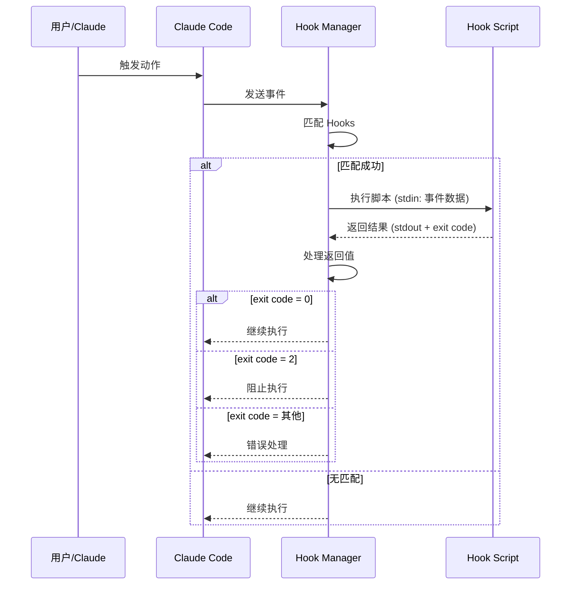
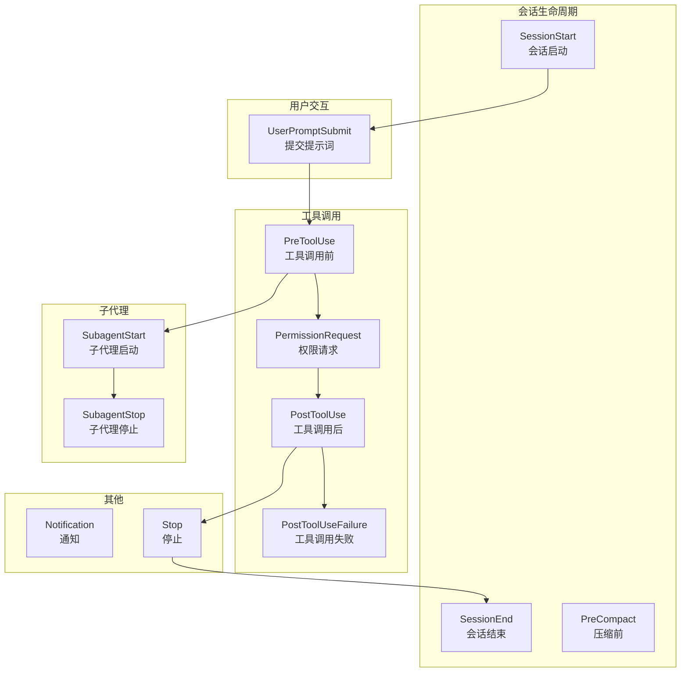
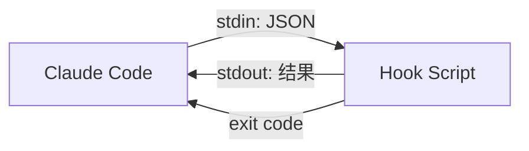

# Hooks 系统：生命周期事件

> Hooks（钩子）是 Claude Code 的自动化引擎，让你能在特定事件发生时自动执行脚本，实现工作流自动化。

## 目录

1. [什么是 Hooks](#1-什么是-hooks)
2. [生命周期事件](#2-生命周期事件)
3. [配置详解](#3-配置详解)
4. [Matcher 模式](#4-matcher-模式)
5. [Hook 脚本编写](#5-hook-脚本编写)
6. [高级特性](#6-高级特性)
7. [实战案例](#7-实战案例)
8. [最佳实践](#8-最佳实践)
9. [常见问题](#9-常见问题)

---

## 1. 什么是 Hooks

### 1.1 定义

Hooks 是 **事件驱动的自动化机制**，允许你在 Claude Code 的特定生命周期事件发生时执行自定义脚本或命令。

### 1.2 核心价值

| 场景 | 无 Hooks | 有 Hooks |
|------|----------|----------|
| 代码格式化 | 每次手动运行 prettier | 文件保存后自动格式化 |
| 安全检查 | 容易遗忘 | 每次修改自动检查 |
| 上下文注入 | 手动复制粘贴 | 会话启动自动注入 |
| 权限控制 | Claude 可能执行危险操作 | 自动拦截并确认 |

### 1.3 工作原理



---

## 2. 生命周期事件

Claude Code 提供 12 种生命周期事件：

### 2.1 事件总览



### 2.2 事件详解

#### SessionStart - 会话启动

**触发时机**：会话启动、恢复、清除、压缩时

**典型用途**：
- 注入项目上下文（Git 状态、TODO 列表）
- 加载 Skills 元数据
- 设置环境变量

**事件数据**：
```json
{
  "event": "SessionStart",
  "trigger": "startup|resume|clear|compact"
}
```

---

#### UserPromptSubmit - 用户提交提示词

**触发时机**：用户发送消息后，Claude 处理前

**典型用途**：
- 追加动态上下文
- 请求转换/预处理
- 日志记录

**事件数据**：
```json
{
  "event": "UserPromptSubmit",
  "prompt": "用户输入的内容"
}
```

---

#### PreToolUse - 工具调用前

**触发时机**：Claude 决定调用工具，但尚未执行

**典型用途**：
- 拦截危险操作
- 验证参数
- 修改工具参数

**事件数据**：
```json
{
  "event": "PreToolUse",
  "tool": "Shell",
  "input": {
    "command": "rm -rf /tmp/test"
  }
}
```

---

#### PermissionRequest - 权限请求

**触发时机**：工具需要用户授权前

**典型用途**：
- 自动批准安全操作
- 自动拒绝危险操作
- 自定义权限逻辑

**事件数据**：
```json
{
  "event": "PermissionRequest",
  "tool": "Shell",
  "input": {
    "command": "npm install"
  }
}
```

---

#### PostToolUse - 工具调用后

**触发时机**：工具成功执行后

**典型用途**：
- 运行格式化工具
- 运行 Linter
- 触发构建

**事件数据**：
```json
{
  "event": "PostToolUse",
  "tool": "Write",
  "input": {
    "path": "/path/to/file.ts",
    "content": "..."
  },
  "output": "File written successfully"
}
```

---

#### PostToolUseFailure - 工具调用失败

**触发时机**：工具执行失败后

**典型用途**：
- 错误日志记录
- 错误通知
- 自动重试逻辑

**事件数据**：
```json
{
  "event": "PostToolUseFailure",
  "tool": "Shell",
  "input": {
    "command": "npm test"
  },
  "error": "Exit code: 1"
}
```

---

#### SubagentStart / SubagentStop - 子代理生命周期

**触发时机**：子代理启动/停止时

**典型用途**：
- 监控子代理
- 资源管理
- 日志记录

---

#### Notification - 通知

**触发时机**：系统发送通知时

**典型用途**：
- 自定义通知处理
- 外部系统集成

---

#### Stop - 停止

**触发时机**：Claude 完成响应时

**典型用途**：
- 清理临时文件
- 保存状态
- 发送通知

---

#### PreCompact - 压缩前

**触发时机**：执行 `/compact` 前

**典型用途**：
- 保存重要上下文
- 自定义摘要逻辑

---

#### SessionEnd - 会话结束

**触发时机**：会话完全结束时

**典型用途**：
- 清理资源
- 保存日志
- 发送报告

---

## 3. 配置详解

### 3.1 配置文件位置

```
.claude/hooks/
├── hooks.json          # Hook 配置文件
├── session-start.sh    # Hook 脚本
├── format-on-save.sh   # Hook 脚本
└── security-check.py   # Hook 脚本
```

### 3.2 配置格式

**hooks.json 基本结构**：

```json
{
  "hooks": {
    "EventName": [
      {
        "matcher": "匹配模式",
        "hooks": [
          {
            "type": "command",
            "command": "要执行的命令"
          }
        ]
      }
    ]
  }
}
```

### 3.3 完整配置示例

```json
{
  "hooks": {
    "SessionStart": [
      {
        "matcher": "startup|resume|clear|compact",
        "hooks": [
          {
            "type": "command",
            "command": "${CLAUDE_PLUGIN_ROOT}/hooks/session-start.sh"
          }
        ]
      }
    ],
    "PostToolUse": [
      {
        "matcher": "Write|StrReplace",
        "hooks": [
          {
            "type": "command",
            "command": "prettier --write \"$CLAUDE_FILE_PATH\""
          }
        ]
      }
    ],
    "PreToolUse": [
      {
        "matcher": "Shell",
        "hooks": [
          {
            "type": "command",
            "command": "${CLAUDE_PLUGIN_ROOT}/hooks/security-check.sh"
          }
        ]
      }
    ]
  }
}
```

### 3.4 配置字段说明

| 字段 | 类型 | 说明 |
|------|------|------|
| `matcher` | string | 正则表达式，匹配工具名或触发条件 |
| `hooks` | array | Hook 数组，按顺序执行 |
| `hooks[].type` | string | Hook 类型，目前只支持 `"command"` |
| `hooks[].command` | string | 要执行的 Shell 命令 |

---

## 4. Matcher 模式

### 4.1 基本语法

Matcher 使用正则表达式匹配：

```json
// 匹配单个工具
"matcher": "Write"

// 匹配多个工具
"matcher": "Write|StrReplace|Delete"

// 匹配所有工具
"matcher": ".*"

// 匹配特定模式
"matcher": "Shell.*"
```

### 4.2 工具名称

可用的工具名称：

| 工具 | 说明 |
|------|------|
| `Read` | 读取文件 |
| `Write` | 写入文件 |
| `StrReplace` | 字符串替换 |
| `Delete` | 删除文件 |
| `Shell` | 执行命令 |
| `Glob` | 文件匹配 |
| `Grep` | 内容搜索 |
| `SemanticSearch` | 语义搜索 |
| `WebSearch` | 网络搜索 |
| `WebFetch` | 获取网页 |
| `Task` | 创建子代理 |

### 4.3 MCP 工具匹配

MCP 工具使用 `mcp__serverName__toolName` 格式：

```json
// 匹配特定 MCP 工具
"matcher": "mcp__github__create_pull_request"

// 匹配某个 MCP 服务器的所有工具
"matcher": "mcp__github__.*"

// 匹配所有 MCP 工具
"matcher": "mcp__.*"
```

### 4.4 SessionStart 的 Matcher

对于 `SessionStart` 事件，matcher 匹配触发原因：

```json
"matcher": "startup"         // 仅新会话
"matcher": "resume"          // 仅恢复会话
"matcher": "startup|resume"  // 新会话或恢复
"matcher": ".*"              // 所有情况
```

---

## 5. Hook 脚本编写

### 5.1 输入输出规范

Hook 脚本通过 **stdin** 接收事件数据，通过 **stdout** 返回结果，通过 **exit code** 控制流程。



### 5.2 Exit Code 含义

| Exit Code | 含义 | 行为 |
|-----------|------|------|
| 0 | 成功，继续执行 | stdout 内容追加到上下文 |
| 2 | 阻止操作 | 取消当前工具调用 |
| 其他 | 错误 | 记录错误，继续执行 |

### 5.3 环境变量

Hook 脚本可以访问以下环境变量：

| 变量 | 说明 |
|------|------|
| `CLAUDE_PLUGIN_ROOT` | .claude 目录的绝对路径 |
| `CLAUDE_FILE_PATH` | 当前操作的文件路径（如适用） |
| `CLAUDE_TOOL_NAME` | 当前工具名称 |
| `CLAUDE_SESSION_ID` | 当前会话 ID |

### 5.4 脚本示例

#### Bash 脚本

```bash
#!/bin/bash

# session-start.sh
# 会话启动时注入上下文

# 读取 stdin（事件数据）
EVENT_DATA=$(cat)

# 获取 Git 信息
GIT_BRANCH=$(git branch --show-current 2>/dev/null || echo "N/A")
GIT_STATUS=$(git status --short 2>/dev/null | head -10)

# 输出上下文（会被追加到 Claude 的上下文）
cat << EOF
## 项目状态

**当前分支**: $GIT_BRANCH

**未提交的更改**:
\`\`\`
$GIT_STATUS
\`\`\`
EOF

# 返回成功
exit 0
```

#### Python 脚本

```python
#!/usr/bin/env python3

# security-check.py
# 检查危险命令

import sys
import json

# 读取事件数据
event_data = json.load(sys.stdin)

# 获取命令
command = event_data.get('input', {}).get('command', '')

# 危险命令列表
dangerous_patterns = [
    'rm -rf /',
    'rm -rf ~',
    'dd if=',
    ':(){:|:&};:',
    '> /dev/sda',
]

# 检查危险命令
for pattern in dangerous_patterns:
    if pattern in command:
        print(f"⚠️ 阻止危险命令: {command}")
        sys.exit(2)  # 阻止执行

# 允许执行
sys.exit(0)
```

#### Node.js 脚本

```javascript
#!/usr/bin/env node

// format-on-save.js
// 文件保存后格式化

const fs = require('fs');

// 读取 stdin
let data = '';
process.stdin.on('data', chunk => data += chunk);
process.stdin.on('end', () => {
    const event = JSON.parse(data);
    const filePath = event.input?.path || '';
    
    // 只处理特定文件类型
    if (filePath.match(/\.(js|ts|jsx|tsx)$/)) {
        const { execSync } = require('child_process');
        try {
            execSync(`prettier --write "${filePath}"`);
            console.log(`✅ 已格式化: ${filePath}`);
        } catch (e) {
            console.error(`❌ 格式化失败: ${e.message}`);
        }
    }
    
    process.exit(0);
});
```

---

## 6. 高级特性

### 6.1 Hook 链

多个 Hook 按顺序执行：

```json
{
  "hooks": {
    "PostToolUse": [{
      "matcher": "Write",
      "hooks": [
        {"type": "command", "command": "prettier --write $CLAUDE_FILE_PATH"},
        {"type": "command", "command": "eslint --fix $CLAUDE_FILE_PATH"},
        {"type": "command", "command": "echo '✅ 文件已处理'"}
      ]
    }]
  }
}
```

### 6.2 条件执行

在脚本中实现条件逻辑：

```bash
#!/bin/bash

# 只在特定分支上执行
BRANCH=$(git branch --show-current)
if [ "$BRANCH" = "main" ] || [ "$BRANCH" = "master" ]; then
    echo "⚠️ 正在主分支上操作，请谨慎！"
fi

exit 0
```

### 6.3 异步处理

对于耗时操作，可以使用后台执行：

```bash
#!/bin/bash

# 启动后台任务
nohup ./long-running-task.sh > /tmp/task.log 2>&1 &

# 立即返回
echo "后台任务已启动"
exit 0
```

### 6.4 上下文注入

通过 stdout 注入信息到 Claude 的上下文：

```bash
#!/bin/bash

# 输出的内容会被 Claude 看到
cat << 'EOF'
## 注入的上下文

请注意以下项目规范：
1. 所有 API 必须有单元测试
2. 提交前必须通过 lint 检查
3. 不要直接提交到 main 分支
EOF

exit 0
```

### 6.5 决策控制

使用 JSON 输出更精细地控制行为：

```bash
#!/bin/bash

# 输出 JSON 格式的决策
cat << EOF
{
  "decision": "block",
  "reason": "检测到潜在的安全问题",
  "suggestion": "请使用更安全的方式执行此操作"
}
EOF

exit 2  # 阻止操作
```

---

## 7. 实战案例

### 7.1 案例：自动代码格式化

**目标**：每次写入文件后自动运行 Prettier

**hooks.json**：

```json
{
  "hooks": {
    "PostToolUse": [{
      "matcher": "Write|StrReplace",
      "hooks": [{
        "type": "command",
        "command": "${CLAUDE_PLUGIN_ROOT}/hooks/format.sh"
      }]
    }]
  }
}
```

**format.sh**：

```bash
#!/bin/bash

# 读取事件数据
EVENT=$(cat)
FILE_PATH=$(echo "$EVENT" | jq -r '.input.path // empty')

# 检查文件是否存在且是支持的类型
if [ -n "$FILE_PATH" ] && [ -f "$FILE_PATH" ]; then
    case "$FILE_PATH" in
        *.js|*.jsx|*.ts|*.tsx|*.json|*.md)
            prettier --write "$FILE_PATH" 2>/dev/null
            if [ $? -eq 0 ]; then
                echo "✅ 已格式化: $FILE_PATH"
            fi
            ;;
    esac
fi

exit 0
```

---

### 7.2 案例：危险命令拦截

**目标**：阻止执行危险的 Shell 命令

**hooks.json**：

```json
{
  "hooks": {
    "PreToolUse": [{
      "matcher": "Shell",
      "hooks": [{
        "type": "command",
        "command": "${CLAUDE_PLUGIN_ROOT}/hooks/security-guard.sh"
      }]
    }]
  }
}
```

**security-guard.sh**：

```bash
#!/bin/bash

# 读取事件数据
EVENT=$(cat)
COMMAND=$(echo "$EVENT" | jq -r '.input.command // empty')

# 危险命令模式
DANGEROUS_PATTERNS=(
    "rm -rf /"
    "rm -rf ~"
    "rm -rf \$HOME"
    "> /dev/"
    "mkfs"
    "dd if="
    ":(){:|:&};:"
    "chmod -R 777 /"
)

# 检查危险命令
for pattern in "${DANGEROUS_PATTERNS[@]}"; do
    if [[ "$COMMAND" == *"$pattern"* ]]; then
        echo "🚫 已阻止危险命令: $COMMAND"
        echo "原因: 匹配危险模式 '$pattern'"
        exit 2  # 阻止执行
    fi
done

# 安全，允许执行
exit 0
```

---

### 7.3 案例：会话上下文注入

**目标**：在每次会话启动时注入项目状态

**hooks.json**：

```json
{
  "hooks": {
    "SessionStart": [{
      "matcher": "startup|resume",
      "hooks": [{
        "type": "command",
        "command": "${CLAUDE_PLUGIN_ROOT}/hooks/session-start.sh"
      }]
    }]
  }
}
```

**session-start.sh**：

```bash
#!/bin/bash

# 获取项目信息
PROJECT_ROOT=$(git rev-parse --show-toplevel 2>/dev/null || pwd)
GIT_BRANCH=$(git branch --show-current 2>/dev/null || echo "N/A")
LAST_COMMIT=$(git log -1 --oneline 2>/dev/null || echo "N/A")
UNCOMMITTED=$(git status --short 2>/dev/null | wc -l | tr -d ' ')

# 获取 TODO 数量
TODO_COUNT=$(grep -r "TODO" --include="*.java" --include="*.ts" "$PROJECT_ROOT/src" 2>/dev/null | wc -l | tr -d ' ')

# 输出上下文
cat << EOF
<session_context>
## 项目状态

| 项目 | 值 |
|------|-----|
| 当前分支 | \`$GIT_BRANCH\` |
| 最近提交 | $LAST_COMMIT |
| 未提交文件 | $UNCOMMITTED 个 |
| TODO 数量 | $TODO_COUNT 个 |

## 提醒

- 当前在 \`$GIT_BRANCH\` 分支工作
- 请先使用 using-superpowers 技能检查可用技能
</session_context>
EOF

exit 0
```

---

### 7.4 案例：自动权限审批

**目标**：自动批准安全的读取操作

**hooks.json**：

```json
{
  "hooks": {
    "PermissionRequest": [{
      "matcher": "Read|Glob|Grep",
      "hooks": [{
        "type": "command",
        "command": "echo '{\"decision\": \"approve\"}' && exit 0"
      }]
    }]
  }
}
```

更复杂的审批逻辑：

```bash
#!/bin/bash

EVENT=$(cat)
TOOL=$(echo "$EVENT" | jq -r '.tool')
FILE_PATH=$(echo "$EVENT" | jq -r '.input.path // empty')

# 读取操作自动批准
if [ "$TOOL" = "Read" ] || [ "$TOOL" = "Glob" ] || [ "$TOOL" = "Grep" ]; then
    exit 0  # 批准
fi

# 写入操作检查路径
if [ "$TOOL" = "Write" ] || [ "$TOOL" = "StrReplace" ]; then
    # 允许写入 src 目录
    if [[ "$FILE_PATH" == *"/src/"* ]]; then
        exit 0  # 批准
    fi
    # 禁止写入配置文件
    if [[ "$FILE_PATH" == *".env"* ]] || [[ "$FILE_PATH" == *"config"* ]]; then
        echo "🚫 禁止修改配置文件"
        exit 2  # 拒绝
    fi
fi

# 其他情况由用户决定
exit 0
```

---

## 8. 最佳实践

### 8.1 设计原则

| 原则 | 说明 |
|------|------|
| **快速响应** | Hook 脚本应该快速执行（< 1秒） |
| **失败安全** | 脚本错误不应阻止正常工作流 |
| **最小权限** | 只请求必要的权限 |
| **日志记录** | 记录重要操作便于调试 |

### 8.2 性能优化

```bash
# ❌ 不好：每次都启动新进程
"command": "node script.js"

# ✅ 好：使用轻量级脚本
"command": "bash script.sh"

# ❌ 不好：同步等待耗时操作
npm install && echo "done"

# ✅ 好：异步处理耗时操作
nohup npm install &
echo "started"
```

### 8.3 错误处理

```bash
#!/bin/bash

# 设置错误处理
set -e

# 使用 trap 捕获错误
trap 'echo "脚本执行出错"; exit 0' ERR

# 检查依赖
command -v jq >/dev/null 2>&1 || {
    echo "警告: jq 未安装，跳过处理"
    exit 0
}

# 主逻辑
# ...
```

### 8.4 调试技巧

```bash
# 开启调试模式
set -x

# 记录日志
exec > >(tee -a /tmp/hook.log) 2>&1

# 打印事件数据
EVENT=$(cat)
echo "收到事件: $EVENT" >> /tmp/hook-debug.log

# 检查变量
echo "FILE_PATH=$CLAUDE_FILE_PATH" >> /tmp/hook-debug.log
```

### 8.5 安全考虑

```bash
# ❌ 不好：直接使用未验证的输入
rm -rf "$USER_INPUT"

# ✅ 好：验证和清理输入
if [[ "$USER_INPUT" =~ ^[a-zA-Z0-9_-]+$ ]]; then
    rm -rf "/safe/path/$USER_INPUT"
fi

# ❌ 不好：暴露敏感信息
echo "API_KEY=$API_KEY"

# ✅ 好：隐藏敏感信息
echo "API_KEY=****"
```

---

## 9. 常见问题

### Q: Hook 脚本没有执行怎么办？

**A**: 检查以下几点：
1. 脚本是否有执行权限（`chmod +x script.sh`）
2. hooks.json 格式是否正确（使用 JSON 验证器）
3. matcher 是否匹配目标事件
4. 查看 Claude Code 日志

### Q: 如何调试 Hook 脚本？

**A**: 
```bash
# 添加日志
echo "DEBUG: $VARIABLE" >> /tmp/hook.log

# 在脚本开头添加
exec > >(tee -a /tmp/hook.log) 2>&1
set -x
```

### Q: Hook 脚本可以访问网络吗？

**A**: 是的，Hook 脚本在你的本地环境执行，拥有你的用户权限，可以访问网络。

### Q: 如何在 Windows 上使用 Hooks？

**A**: 
1. 使用 `.cmd` 或 `.bat` 脚本
2. 或者安装 WSL/Git Bash 使用 Shell 脚本
3. 或者使用跨平台脚本语言（Python、Node.js）

### Q: Hook 执行超时怎么处理？

**A**: 默认没有超时限制，建议：
1. 避免在 Hook 中执行耗时操作
2. 使用后台执行（`&`）处理长时间任务
3. 在脚本中设置自己的超时

```bash
# 设置 5 秒超时
timeout 5 some-command || echo "超时"
```

### Q: 多个 Hook 的执行顺序是什么？

**A**: 
1. 同一事件的多个配置按 JSON 数组顺序执行
2. 同一配置的多个 hooks 按数组顺序执行
3. 如果某个 Hook 返回 exit code 2，后续 Hook 不会执行

---

## 下一步

- [Agents 系统](/CICD-Practice/claude-code-guide/05-agents/) - 了解子代理的生命周期事件
- [Skills 系统](/CICD-Practice/claude-code-guide/02-skills/) - 学习如何在技能中利用 Hooks
- [MCP](/CICD-Practice/claude-code-guide/07-mcp/) - 了解如何为 MCP 工具配置 Hooks
