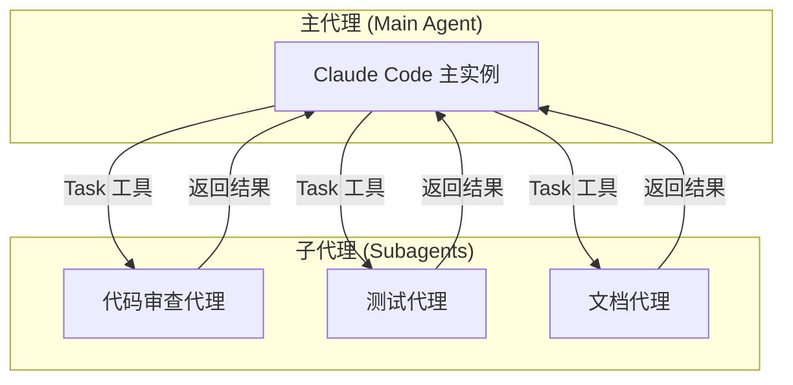
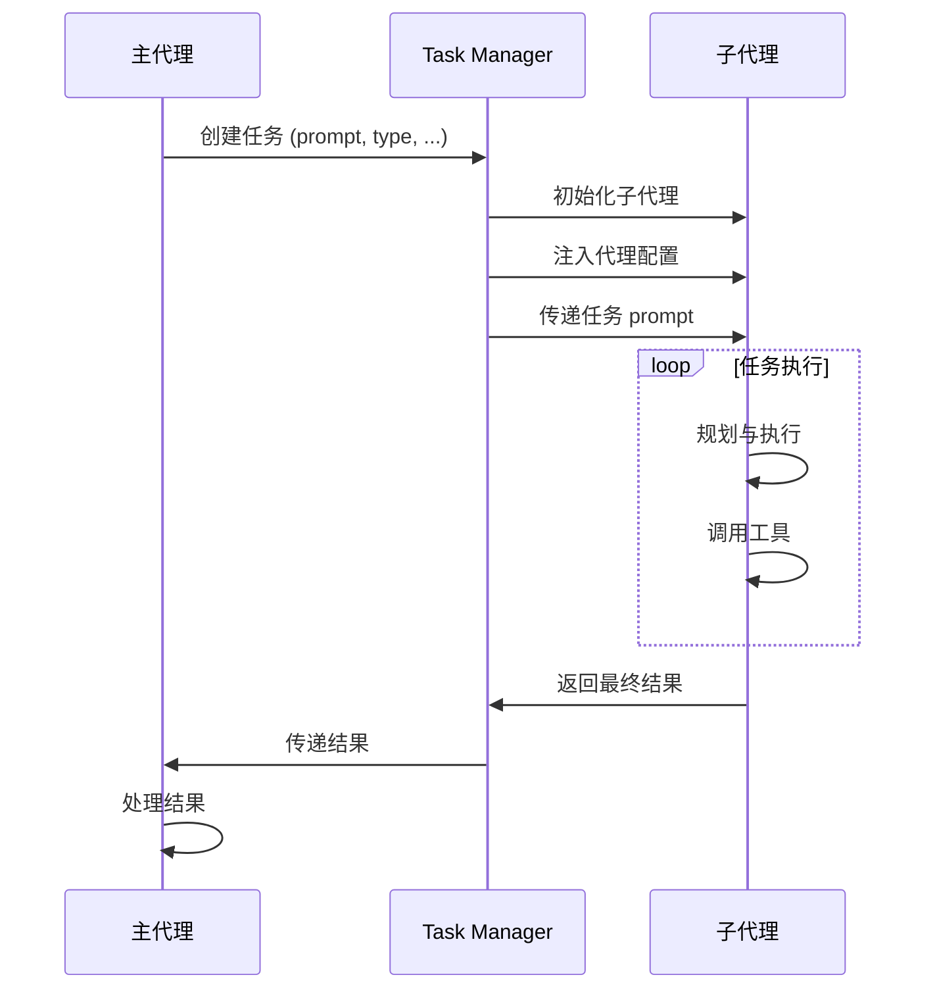
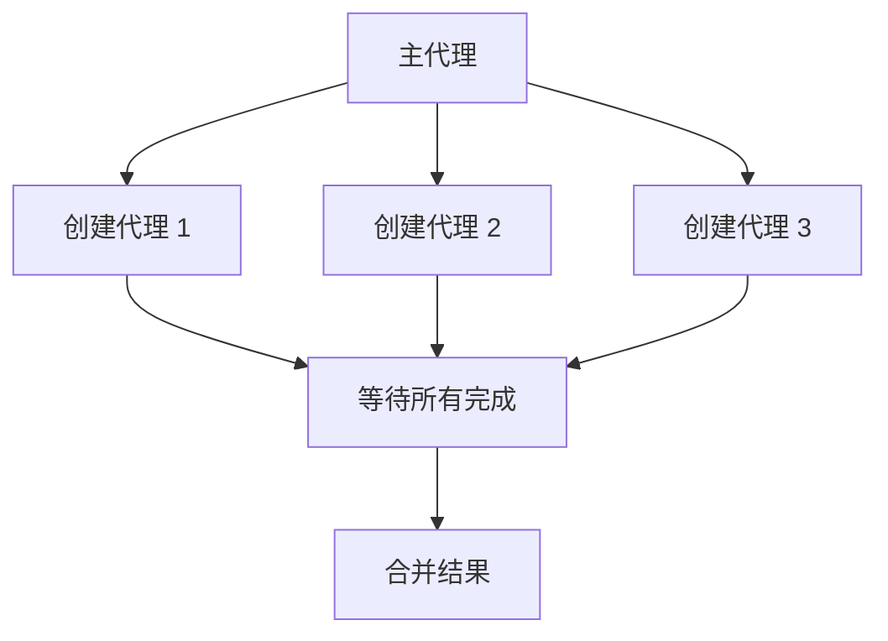
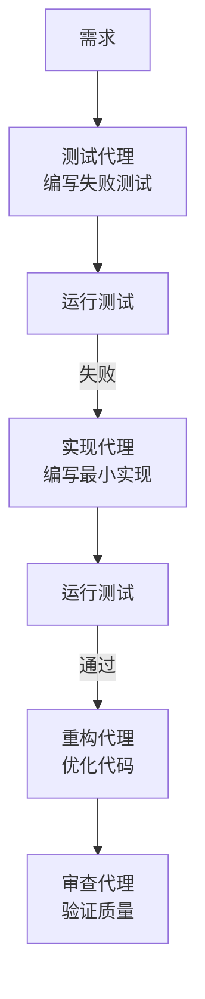

# Agents 系统：专业化代理

> Agents（代理）是 Claude Code 的分身能力，允许你创建专注于特定任务的独立 Claude 实例，实现并行处理和专业化分工。

## 目录

1. [什么是 Agents](#1-什么是-agents)
2. [代理类型](#2-代理类型)
3. [代理配置](#3-代理配置)
4. [Task 工具详解](#4-task-工具详解)
5. [代理通信机制](#5-代理通信机制)
6. [高级特性](#6-高级特性)
7. [实战案例](#7-实战案例)
8. [最佳实践](#8-最佳实践)
9. [常见问题](#9-常见问题)

---

## 1. 什么是 Agents

### 1.1 定义

Agents（代理）是 **独立运行的 Claude 实例**，拥有自己的上下文和工具访问权限，可以执行特定领域的任务。

### 1.2 为什么需要代理

| 场景 | 无代理 | 有代理 |
|------|--------|--------|
| 多任务处理 | 顺序执行，效率低 | 并行执行，速度快 |
| 上下文隔离 | 所有任务共享上下文，容易混乱 | 每个任务独立上下文，清晰 |
| 专业分工 | 通用提示，质量不稳定 | 专业提示，质量有保障 |
| 错误隔离 | 一个任务失败影响全局 | 失败仅影响单个代理 |

### 1.3 核心概念



---

## 2. 代理类型

### 2.1 内置代理类型

Claude Code 提供了几种预定义的代理类型：

| 类型 | 说明 | 工具权限 |
|------|------|----------|
| `generalPurpose` | 通用代理 | 完整工具访问 |
| `explore` | 探索代理 | 只读，用于代码分析 |
| `shell` | Shell 代理 | 专注命令执行 |
| `code-reviewer` | 代码审查代理 | 只读，专注审查 |

### 2.2 自定义代理

你可以通过 `.claude/agents/` 目录定义自定义代理：

```
.claude/agents/
├── code-reviewer.md      # 代码审查代理
├── test-writer.md        # 测试编写代理
├── doc-generator.md      # 文档生成代理
└── security-auditor.md   # 安全审计代理
```

### 2.3 代理模型选择

不同代理可以使用不同的模型：

| 模型 | 成本 | 智能度 | 适用场景 |
|------|------|--------|----------|
| `fast` (Haiku) | 低 | 中等 | 简单任务、快速迭代 |
| 默认 (Sonnet) | 中 | 高 | 平衡场景 |
| Opus | 高 | 最高 | 复杂推理任务 |

---

## 3. 代理配置

### 3.1 配置文件格式

**`.claude/agents/code-reviewer.md`**：

~~~markdown
# 代码审查代理

你是一个专业的代码审查专家，专注于：

## 审查重点

1. **代码质量**
   - 可读性
   - 可维护性
   - 设计模式使用

2. **安全问题**
   - 输入验证
   - 注入风险
   - 权限检查

3. **性能问题**
   - 算法复杂度
   - 资源泄漏
   - 不必要的计算

## 输出格式

使用以下格式输出审查结果：

### 严重问题
- [ ] 问题描述

### 警告
- [ ] 警告描述

### 建议
- [ ] 建议描述

## 约束

- 只提供建设性的反馈
- 不要重写代码，只指出问题
- 优先级：安全 > 性能 > 可读性
~~~

### 3.2 配置要素

| 要素 | 说明 | 是否必需 |
|------|------|----------|
| 角色定义 | 明确代理的专业领域 | ✅ |
| 任务边界 | 代理应该做什么和不做什么 | ✅ |
| 输出格式 | 期望的输出结构 | 推荐 |
| 工具限制 | 允许使用的工具列表 | 可选 |
| 约束条件 | 特殊限制和要求 | 可选 |

### 3.3 工具权限控制

在代理配置中限制工具：

~~~markdown
# 只读审查代理

## 允许的工具

- Read: 读取文件
- Grep: 搜索代码
- Glob: 查找文件
- SemanticSearch: 语义搜索

## 禁止的工具

- Write: 不允许写入
- Shell: 不允许执行命令
- Delete: 不允许删除
~~~

---

## 4. Task 工具详解

### 4.1 基本语法

`Task` 工具用于创建和管理子代理：

```typescript
interface TaskParams {
  prompt: string;           // 任务描述（必需）
  description: string;      // 简短描述（必需）
  subagent_type?: string;   // 代理类型
  model?: string;           // 使用的模型
  readonly?: boolean;       // 是否只读
  attachments?: string[];   // 附件文件
  resume?: string;          // 恢复代理 ID
}
```

### 4.2 使用示例

#### 基本用法

```
创建一个代理来审查 src/main/java/Service.java 的代码质量
```

Claude 内部会调用：

```json
{
  "tool": "Task",
  "input": {
    "prompt": "审查 src/main/java/Service.java 的代码质量，关注安全、性能、可读性...",
    "description": "审查 Service.java",
    "subagent_type": "code-reviewer",
    "readonly": true
  }
}
```

#### 并行代理

```
同时执行以下任务：
1. 审查 UserService.java
2. 审查 OrderService.java
3. 审查 PaymentService.java
```

Claude 会并行创建三个代理。

### 4.3 代理类型详解

#### generalPurpose（通用代理）

```json
{
  "subagent_type": "generalPurpose",
  "prompt": "分析这个项目的架构并提供改进建议"
}
```

适用于：
- 复杂的多步骤任务
- 需要完整工具访问的任务
- 探索性任务

#### explore（探索代理）

```json
{
  "subagent_type": "explore",
  "prompt": "这个项目的认证流程是如何工作的？"
}
```

适用于：
- 代码库探索
- 架构分析
- 问题定位

特点：
- 速度快
- 只读操作
- 专注搜索和分析

#### shell（Shell 代理）

```json
{
  "subagent_type": "shell",
  "prompt": "运行测试并报告结果"
}
```

适用于：
- Git 操作
- 构建任务
- 系统命令

#### code-reviewer（代码审查代理）

```json
{
  "subagent_type": "code-reviewer",
  "prompt": "审查这个 PR 的所有更改"
}
```

适用于：
- 代码审查
- 质量检查
- 安全审计

### 4.4 恢复代理

代理完成后返回一个 ID，可以用于恢复：

```json
{
  "resume": "agent-id-12345",
  "prompt": "基于之前的分析，现在修复发现的问题"
}
```

---

## 5. 代理通信机制

### 5.1 数据流



### 5.2 上下文隔离

子代理有独立的上下文，**不会**继承：
- 主代理的对话历史
- 主代理加载的文件内容
- 主代理的临时状态

子代理**会**继承：
- 项目的 CLAUDE.md 规则
- 代理配置文件
- Skills 元数据

### 5.3 结果传递

子代理完成后，只有最终输出会返回给主代理：


这意味着：
- 中间过程不可见
- 需要在 prompt 中明确要求返回格式
- 大量数据需要考虑压缩

---

## 6. 高级特性

### 6.1 并行代理调度

当多个任务相互独立时，可以并行执行：



**最佳实践**：
- 最多同时创建 4 个代理
- 确保任务真正独立
- 结果需要手动合并

### 6.2 代理链

复杂任务可以通过代理链完成：


**实现方式**：

~~~markdown
# 复杂任务分解

1. 首先使用 explore 代理分析问题
2. 根据分析结果，使用 generalPurpose 代理制定计划
3. 执行计划
4. 使用 code-reviewer 代理验证结果
~~~

### 6.3 代理状态恢复

```json
// 第一次调用
{
  "prompt": "分析项目架构",
  "subagent_type": "explore"
}
// 返回: { "agentId": "abc123", "result": "..." }

// 后续调用，恢复上下文
{
  "resume": "abc123",
  "prompt": "基于之前的分析，详细说明数据流"
}
```

### 6.4 附件传递

向代理传递文件：

```json
{
  "prompt": "分析这个截图中的 UI 问题",
  "attachments": [
    "/path/to/screenshot.png"
  ]
}
```

支持的附件类型：
- 图片：png, jpg, gif, webp
- 视频：mp4, webm（部分模型）

### 6.5 只读模式

确保代理不会修改任何文件：

```json
{
  "prompt": "审查这个模块的代码质量",
  "readonly": true
}
```

只读模式下禁用的工具：
- Write
- StrReplace
- Delete
- Shell（部分命令）

---

## 7. 实战案例

### 7.1 案例：并行代码审查

**场景**：审查多个文件的代码质量

**代理配置** `.claude/agents/code-reviewer.md`：

~~~markdown
# 代码审查代理

你是专业的代码审查员，负责审查 Java/Kotlin 代码。

## 审查清单

### 1. 代码质量
- [ ] 命名是否清晰
- [ ] 方法是否过长（> 30 行）
- [ ] 类是否过大（> 300 行）
- [ ] 是否有重复代码

### 2. 安全
- [ ] SQL 注入风险
- [ ] XSS 风险
- [ ] 敏感数据暴露

### 3. 性能
- [ ] N+1 查询
- [ ] 不必要的循环
- [ ] 资源未关闭

## 输出格式

```json
{
  "file": "文件路径",
  "issues": [
    {
      "severity": "critical|warning|info",
      "line": 行号,
      "message": "问题描述",
      "suggestion": "修复建议"
    }
  ],
  "summary": "总体评价"
}
```
~~~

**使用技能** `.claude/skills/parallel-review/SKILL.md`：

~~~markdown
---
name: parallel-review
description: 并行审查多个文件
---

# 并行代码审查

## 执行步骤

1. 识别需要审查的文件列表
2. 为每个文件创建独立的 code-reviewer 代理
3. 并行执行审查（最多 4 个同时）
4. 收集所有结果
5. 生成汇总报告

## 汇总报告格式

# 代码审查报告

## 统计

| 文件 | 严重 | 警告 | 建议 |
|------|------|------|------|
| ... | ... | ... | ... |

## 详细问题

### 文件 1
...

### 文件 2
...

## 优先修复建议

1. ...
2. ...
~~~

---

### 7.2 案例：代理驱动的 TDD

**场景**：使用代理实现测试驱动开发

~~~markdown
---
name: agent-tdd
description: 代理驱动的 TDD 流程
---

# 代理驱动 TDD

## 流程



## 代理分工

### 测试代理
- 职责：编写单元测试
- 模型：fast（简单任务）
- 工具：Read, Write

### 实现代理
- 职责：编写实现代码
- 模型：default
- 工具：Read, Write, Shell（运行测试）

### 重构代理
- 职责：优化代码结构
- 模型：default
- 工具：Read, StrReplace

### 审查代理
- 职责：验证最终质量
- 模型：default
- 工具：Read, Grep
- 只读模式
~~~

---

### 7.3 案例：探索性分析

**场景**：快速理解陌生代码库

~~~markdown
---
name: codebase-explorer
description: 探索代码库架构
---

# 代码库探索

## 探索策略

使用 explore 代理进行快速分析：

1. **项目结构分析**
   ```
   "分析这个项目的目录结构，识别主要模块"
   ```

2. **入口点识别**
   ```
   "找到这个项目的入口点（main 函数、启动类等）"
   ```

3. **依赖分析**
   ```
   "分析项目的外部依赖，列出主要使用的框架和库"
   ```

4. **数据流追踪**
   ```
   "从用户请求到数据库，追踪一个典型的数据流"
   ```

## 并行探索

可以同时启动多个探索代理：

| 代理 | 任务 | 问题 |
|------|------|------|
| 代理 1 | 架构 | "项目的整体架构是什么？" |
| 代理 2 | 数据 | "数据是如何存储和访问的？" |
| 代理 3 | 安全 | "认证和授权是如何实现的？" |
| 代理 4 | API | "对外提供了哪些 API？" |

## 输出

汇总各代理的分析结果，生成项目概览文档。
~~~

---

### 7.4 案例：文档生成流水线

**场景**：为代码自动生成文档

~~~markdown
---
name: doc-pipeline
description: 文档生成流水线
---

# 文档生成流水线

## 阶段

### 阶段 1：代码分析（explore 代理）
- 识别公开 API
- 提取代码注释
- 分析参数和返回值

### 阶段 2：文档生成（generalPurpose 代理）
- 生成 API 文档
- 生成使用示例
- 生成架构图

### 阶段 3：质量检查（code-reviewer 代理）
- 检查文档完整性
- 验证示例代码
- 检查链接有效性

## 输出结构

docs/
├── api/
│   ├── overview.md
│   ├── UserService.md
│   └── OrderService.md
├── guides/
│   ├── getting-started.md
│   └── configuration.md
└── architecture/
    └── overview.md
~~~

---

## 8. 最佳实践

### 8.1 代理设计原则

| 原则 | 说明 |
|------|------|
| **单一职责** | 每个代理专注一个领域 |
| **明确边界** | 清楚定义代理能做什么和不能做什么 |
| **输出规范** | 明确指定输出格式 |
| **失败处理** | 考虑代理失败的情况 |

### 8.2 何时使用代理

✅ **适合使用代理**：
- 任务可以并行执行
- 需要隔离上下文
- 需要专业化处理
- 任务之间独立

❌ **不适合使用代理**：
- 简单的单步任务
- 任务之间高度依赖
- 需要共享大量上下文
- 实时交互场景

### 8.3 性能考虑

```
✅ 好的做法
- 批量任务使用并行代理
- 简单任务使用 fast 模型
- 只读任务启用 readonly

❌ 不好的做法
- 为每个小任务创建代理
- 所有代理都用最强模型
- 创建过多并行代理（> 4）
```

### 8.4 调试技巧

1. **查看代理日志**
   ```
   "显示上一个代理的执行日志"
   ```

2. **单步执行**
   ```
   "先只执行第一个代理，让我检查结果"
   ```

3. **降级测试**
   ```
   "用 fast 模型测试一下这个代理配置"
   ```

---

## 9. 常见问题

### Q: 代理之间可以直接通信吗？

**A**: 不能。代理之间是隔离的，只能通过主代理传递信息。如果需要协作，可以：
1. 将一个代理的输出作为另一个代理的输入
2. 使用主代理协调和汇总

### Q: 代理可以访问主代理的对话历史吗？

**A**: 不能。代理有独立的上下文。需要共享的信息必须在 prompt 中明确传递。

### Q: 代理的执行时间有限制吗？

**A**: 没有硬性限制，但代理会像主会话一样消耗 Token。长时间运行的代理应该考虑分解任务。

### Q: 如何限制代理的工具访问？

**A**: 
1. 使用预定义的 `subagent_type`（如 `explore`、`code-reviewer`）
2. 使用 `readonly: true` 参数
3. 在代理配置文件中声明允许的工具

### Q: 代理失败了怎么办？

**A**: 
1. 检查代理返回的错误信息
2. 使用 `resume` 参数恢复并修正
3. 简化任务或分解为更小的步骤

### Q: 可以自定义代理类型吗？

**A**: 是的，在 `.claude/agents/` 目录创建 `.md` 配置文件即可。然后在 Task 工具中通过 `subagent_type` 引用。

---

## 下一步

- [Tools 系统](/CICD-Practice/claude-code-guide/06-tools/) - 了解代理可以使用的工具
- [Hooks 系统](/CICD-Practice/claude-code-guide/04-hooks/) - 学习 SubagentStart/SubagentStop 事件
- [Skills 系统](/CICD-Practice/claude-code-guide/02-skills/) - 在技能中使用代理
