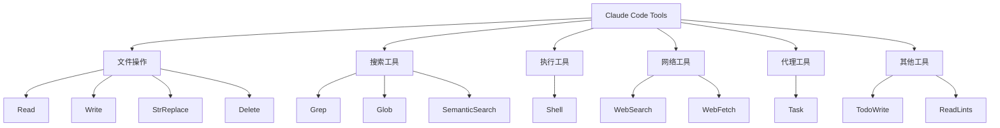
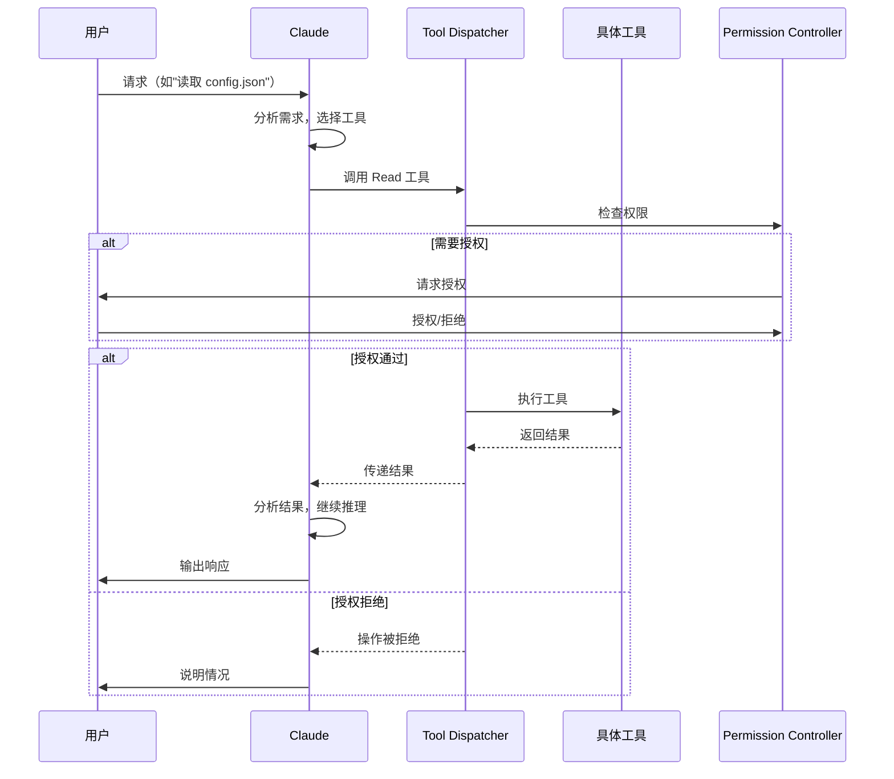
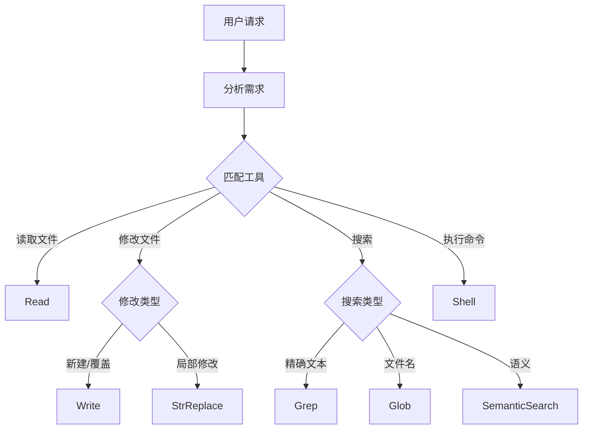
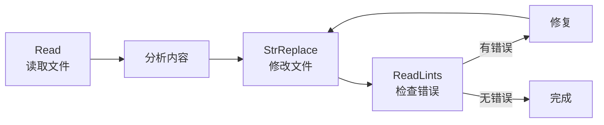
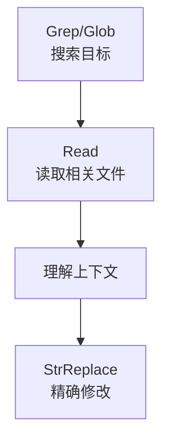
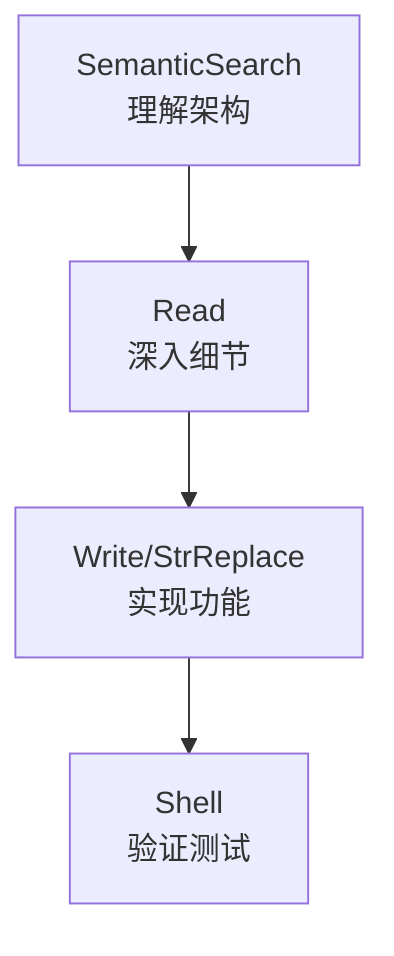
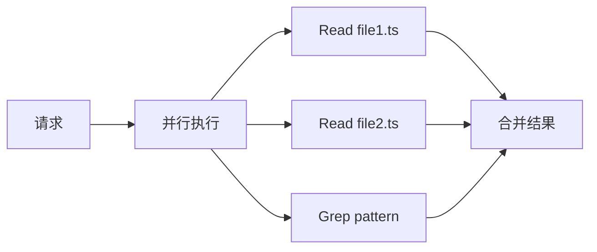
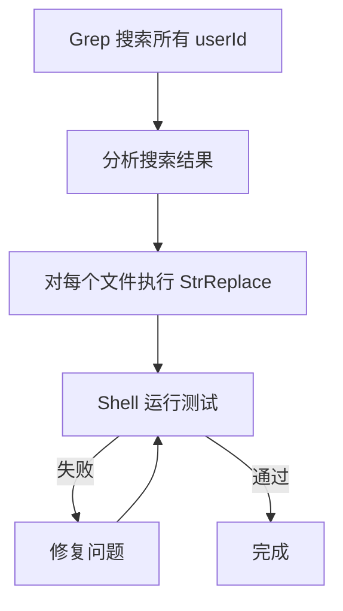
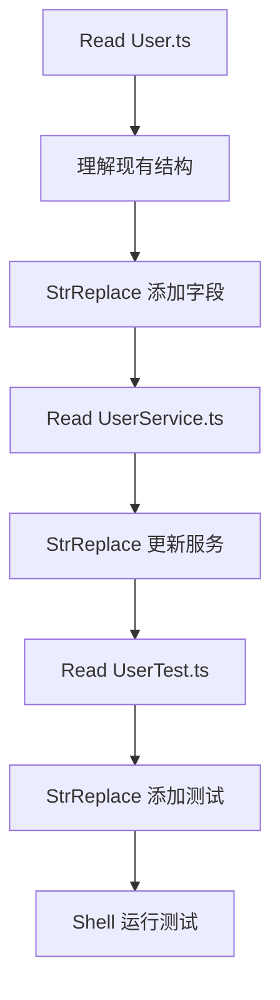
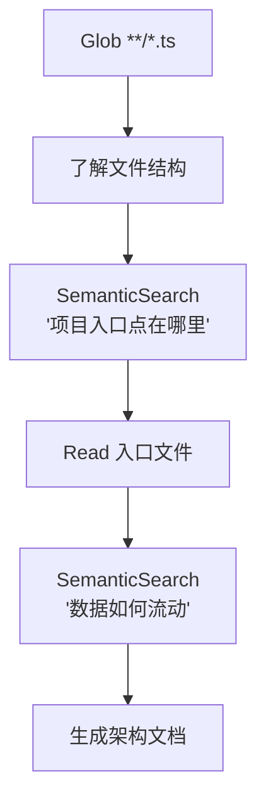

# Tools 系统：Claude 可调用的能力

> Tools（工具）是 Claude Code 与外部世界交互的桥梁，让 Claude 能够读写文件、执行命令、搜索代码，真正成为一个有行动能力的助手。

## 目录

1. [什么是 Tools](#1-什么是-tools)
2. [工具调用机制](#2-工具调用机制)
3. [内置工具详解](#3-内置工具详解)
4. [工具组合模式](#4-工具组合模式)
5. [权限与安全](#5-权限与安全)
6. [高级特性](#6-高级特性)
7. [实战案例](#7-实战案例)
8. [最佳实践](#8-最佳实践)
9. [常见问题](#9-常见问题)

---

## 1. 什么是 Tools

### 1.1 定义

Tools 是 **Claude 可以调用的函数**，每个工具封装了一个特定的能力（如读取文件、执行命令）。通过工具，Claude 从"只能对话"变成"能够行动"。

### 1.2 工具 vs 普通函数

| 特性 | 普通函数 | Claude Tools |
|------|----------|--------------|
| 调用者 | 代码 | AI 模型 |
| 参数 | 编译时确定 | 运行时推断 |
| 描述 | 可选 | 必需（供 AI 理解） |
| 权限 | 代码控制 | 用户授权 |

### 1.3 工具分类



---

## 2. 工具调用机制

### 2.1 调用流程



### 2.2 工具定义结构

每个工具都有以下属性：

```typescript
interface Tool {
  name: string;           // 工具名称
  description: string;    // 功能描述（供 Claude 理解）
  parameters: {           // 参数定义
    type: "object";
    properties: {
      [key: string]: {
        type: string;
        description: string;
        required?: boolean;
      }
    }
  };
}
```

### 2.3 工具选择逻辑

Claude 基于以下因素选择工具：

1. **任务类型**：读取文件 → Read，搜索代码 → Grep
2. **参数匹配**：用户提供的信息是否足够
3. **上下文**：之前的操作结果
4. **效率**：选择最直接的工具



---

## 3. 内置工具详解

### 3.1 文件操作工具

#### Read - 读取文件

**功能**：读取文件内容

**参数**：

| 参数 | 类型 | 必需 | 说明 |
|------|------|------|------|
| `path` | string | ✅ | 文件绝对路径 |
| `offset` | number | ❌ | 起始行号 |
| `limit` | number | ❌ | 读取行数 |

**示例**：

```json
{
  "tool": "Read",
  "input": {
    "path": "/home/user/project/src/main.ts"
  }
}
```

**支持的文件类型**：
- 文本文件（代码、配置、文档）
- 图片（jpeg, png, gif, webp）
- PDF（自动转换为文本）

**最佳实践**：
- 大文件使用 `offset` 和 `limit` 分段读取
- 图片文件直接读取，无需特殊处理

---

#### Write - 写入文件

**功能**：创建或覆盖文件

**参数**：

| 参数 | 类型 | 必需 | 说明 |
|------|------|------|------|
| `path` | string | ✅ | 文件绝对路径 |
| `contents` | string | ✅ | 文件内容 |

**示例**：

```json
{
  "tool": "Write",
  "input": {
    "path": "/home/user/project/src/new-file.ts",
    "contents": "export const hello = 'world';"
  }
}
```

**注意事项**：
- 会覆盖已存在的文件
- 自动创建父目录
- 优先使用 StrReplace 进行局部修改

---

#### StrReplace - 字符串替换

**功能**：在文件中精确替换文本

**参数**：

| 参数 | 类型 | 必需 | 说明 |
|------|------|------|------|
| `path` | string | ✅ | 文件绝对路径 |
| `old_string` | string | ✅ | 要替换的原文本 |
| `new_string` | string | ✅ | 替换后的新文本 |
| `replace_all` | boolean | ❌ | 是否替换所有匹配 |

**示例**：

```json
{
  "tool": "StrReplace",
  "input": {
    "path": "/home/user/project/src/config.ts",
    "old_string": "const API_URL = 'http://localhost:3000'",
    "new_string": "const API_URL = 'https://api.example.com'"
  }
}
```

**关键规则**：
- `old_string` 必须在文件中唯一存在
- 如果有多处匹配，需要包含更多上下文使其唯一
- 或使用 `replace_all: true` 替换所有

---

#### Delete - 删除文件

**功能**：删除指定文件

**参数**：

| 参数 | 类型 | 必需 | 说明 |
|------|------|------|------|
| `path` | string | ✅ | 文件绝对路径 |

**示例**：

```json
{
  "tool": "Delete",
  "input": {
    "path": "/home/user/project/src/deprecated.ts"
  }
}
```

---

### 3.2 搜索工具

#### Grep - 正则搜索

**功能**：在文件中搜索匹配正则表达式的内容

**参数**：

| 参数 | 类型 | 必需 | 说明 |
|------|------|------|------|
| `pattern` | string | ✅ | 正则表达式模式 |
| `path` | string | ❌ | 搜索路径 |
| `glob` | string | ❌ | 文件过滤模式 |
| `type` | string | ❌ | 文件类型（js, py, java...） |
| `-i` | boolean | ❌ | 忽略大小写 |
| `-A` | number | ❌ | 显示匹配后 N 行 |
| `-B` | number | ❌ | 显示匹配前 N 行 |
| `-C` | number | ❌ | 显示匹配前后 N 行 |

**示例**：

```json
{
  "tool": "Grep",
  "input": {
    "pattern": "function.*export",
    "path": "/home/user/project/src",
    "type": "ts",
    "-i": true,
    "-C": 3
  }
}
```

**输出模式**：
- `content`（默认）：显示匹配行内容
- `files_with_matches`：只显示文件路径
- `count`：显示匹配计数

---

#### Glob - 文件查找

**功能**：按模式查找文件

**参数**：

| 参数 | 类型 | 必需 | 说明 |
|------|------|------|------|
| `glob_pattern` | string | ✅ | Glob 模式 |
| `target_directory` | string | ❌ | 搜索目录 |

**示例**：

```json
{
  "tool": "Glob",
  "input": {
    "glob_pattern": "**/*.test.ts",
    "target_directory": "/home/user/project"
  }
}
```

**常用模式**：
- `*.ts` - 当前目录所有 .ts 文件
- `**/*.ts` - 递归所有 .ts 文件
- `src/**/*.{ts,tsx}` - src 下所有 ts/tsx 文件
- `!**/node_modules/**` - 排除 node_modules

---

#### SemanticSearch - 语义搜索

**功能**：通过自然语言查询搜索代码

**参数**：

| 参数 | 类型 | 必需 | 说明 |
|------|------|------|------|
| `query` | string | ✅ | 自然语言查询 |
| `target_directories` | string[] | ❌ | 搜索目录列表 |
| `num_results` | number | ❌ | 返回结果数量（最大 15） |

**示例**：

```json
{
  "tool": "SemanticSearch",
  "input": {
    "query": "用户认证是如何实现的？",
    "target_directories": ["/home/user/project/src"],
    "num_results": 10
  }
}
```

**适用场景**：
- 探索陌生代码库
- 查找功能实现
- 理解代码逻辑

**不适用场景**：
- 精确文本搜索（用 Grep）
- 查找特定文件（用 Glob）

---

### 3.3 执行工具

#### Shell - 执行命令

**功能**：在终端执行 Shell 命令

**参数**：

| 参数 | 类型 | 必需 | 说明 |
|------|------|------|------|
| `command` | string | ✅ | 要执行的命令 |
| `working_directory` | string | ❌ | 工作目录 |
| `description` | string | ❌ | 命令描述 |
| `block_until_ms` | number | ❌ | 阻塞等待时间（毫秒） |

**示例**：

```json
{
  "tool": "Shell",
  "input": {
    "command": "npm run test",
    "working_directory": "/home/user/project",
    "description": "运行单元测试"
  }
}
```

**长时间运行的命令**：

```json
{
  "tool": "Shell",
  "input": {
    "command": "npm run dev",
    "block_until_ms": 0  // 立即后台运行
  }
}
```

**安全限制**：
- 某些危险命令需要用户确认
- 可以通过 Hooks 拦截危险操作

---

### 3.4 网络工具

#### WebSearch - 网络搜索

**功能**：搜索互联网获取实时信息

**参数**：

| 参数 | 类型 | 必需 | 说明 |
|------|------|------|------|
| `search_term` | string | ✅ | 搜索关键词 |
| `explanation` | string | ❌ | 搜索原因说明 |

**示例**：

```json
{
  "tool": "WebSearch",
  "input": {
    "search_term": "Spring Boot 3.2 新特性 2024",
    "explanation": "了解最新版本的特性变化"
  }
}
```

**适用场景**：
- 查询最新技术信息
- 验证当前最佳实践
- 查找文档和教程

---

#### WebFetch - 获取网页

**功能**：获取指定 URL 的内容

**参数**：

| 参数 | 类型 | 必需 | 说明 |
|------|------|------|------|
| `url` | string | ✅ | 目标 URL |

**示例**：

```json
{
  "tool": "WebFetch",
  "input": {
    "url": "https://docs.spring.io/spring-boot/docs/current/reference/html/"
  }
}
```

**限制**：
- 只支持公开可访问的 URL
- 不支持需要认证的页面
- 不支持 localhost/内网地址

---

### 3.5 代理工具

#### Task - 创建子代理

详见 [Agents 系统](/CICD-Practice/claude-code-guide/05-agents/)

---

### 3.6 其他工具

#### TodoWrite - 任务管理

**功能**：管理待办事项列表

**参数**：

| 参数 | 类型 | 必需 | 说明 |
|------|------|------|------|
| `todos` | array | ✅ | 任务数组 |
| `merge` | boolean | ✅ | 是否合并现有任务 |

**示例**：

```json
{
  "tool": "TodoWrite",
  "input": {
    "todos": [
      {"id": "1", "content": "实现用户登录", "status": "completed"},
      {"id": "2", "content": "添加单元测试", "status": "in_progress"},
      {"id": "3", "content": "编写文档", "status": "pending"}
    ],
    "merge": true
  }
}
```

---

#### ReadLints - 读取 Lint 错误

**功能**：获取文件的 Linter 错误

**参数**：

| 参数 | 类型 | 必需 | 说明 |
|------|------|------|------|
| `paths` | string[] | ❌ | 文件路径列表 |

**示例**：

```json
{
  "tool": "ReadLints",
  "input": {
    "paths": ["/home/user/project/src/main.ts"]
  }
}
```

---

## 4. 工具组合模式

### 4.1 读取-修改-验证模式



### 4.2 搜索-定位-修改模式



### 4.3 探索-理解-实现模式



---

## 5. 权限与安全

### 5.1 权限级别

| 工具 | 默认权限 | 风险级别 |
|------|----------|----------|
| Read, Glob, Grep, SemanticSearch | 自动允许 | 低 |
| Write, StrReplace | 需确认/允许 | 中 |
| Shell | 需确认 | 高 |
| Delete | 需确认 | 高 |
| WebSearch, WebFetch | 自动允许 | 低 |

### 5.2 权限配置

通过 `/permissions` 或 `/config` 配置：

```
# 允许特定目录的写入
允许 Write 到 src/
允许 StrReplace 到 src/

# 允许特定命令
允许 Shell npm 命令
允许 Shell git 命令

# 全局允许（谨慎使用）
允许所有 Read 操作
```

### 5.3 安全最佳实践

~~~markdown
## 推荐的权限配置

### 开发环境
- 允许 src/, test/ 目录的所有操作
- 允许 npm, yarn, pnpm 命令
- 允许 git 命令
- 禁止 rm -rf 等危险命令

### 生产环境
- 只允许只读操作
- 禁止 Shell 命令
- 禁止文件删除
~~~

---

## 6. 高级特性

### 6.1 并行工具调用

Claude 可以同时调用多个独立的工具：



### 6.2 工具链自动化

通过 Hooks 在工具执行前后自动触发操作：

```json
{
  "hooks": {
    "PostToolUse": [{
      "matcher": "Write|StrReplace",
      "hooks": [
        {"type": "command", "command": "prettier --write $CLAUDE_FILE_PATH"},
        {"type": "command", "command": "eslint --fix $CLAUDE_FILE_PATH"}
      ]
    }]
  }
}
```

### 6.3 工具结果缓存

某些工具结果会被缓存以提高效率：
- 文件内容（直到文件被修改）
- 搜索结果（同一会话内）

### 6.4 MCP 扩展工具

通过 MCP 协议添加更多工具，详见 [MCP](/CICD-Practice/claude-code-guide/07-mcp/)

---

## 7. 实战案例

### 7.1 案例：重构变量名

**任务**：将项目中的 `userId` 重命名为 `accountId`



**执行步骤**：

1. **搜索所有出现的位置**
   ```json
   {"tool": "Grep", "input": {"pattern": "userId", "path": "src/"}}
   ```

2. **逐文件替换**
   ```json
   {
     "tool": "StrReplace",
     "input": {
       "path": "src/services/UserService.ts",
       "old_string": "userId",
       "new_string": "accountId",
       "replace_all": true
     }
   }
   ```

3. **验证更改**
   ```json
   {"tool": "Shell", "input": {"command": "npm test"}}
   ```

---

### 7.2 案例：添加新功能

**任务**：为 User 类添加 email 字段



---

### 7.3 案例：代码库分析

**任务**：分析项目架构



---

## 8. 最佳实践

### 8.1 工具选择指南

| 任务 | 推荐工具 | 备选工具 |
|------|----------|----------|
| 读取文件内容 | Read | - |
| 创建新文件 | Write | - |
| 修改文件部分内容 | StrReplace | Write（完全重写） |
| 精确文本搜索 | Grep | - |
| 查找文件 | Glob | Shell (find) |
| 理解代码功能 | SemanticSearch | Grep + Read |
| 运行命令 | Shell | - |
| 查询最新信息 | WebSearch | WebFetch |

### 8.2 效率优化

~~~markdown
✅ 好的做法
- 使用 Glob 而不是 Shell find
- 使用 Grep 而不是 Shell grep
- 使用 StrReplace 而不是 Shell sed
- 并行读取多个文件
- 先搜索再读取（而不是读取所有文件）

❌ 不好的做法
- 读取整个大文件（使用 offset/limit）
- 用 Write 进行小修改（用 StrReplace）
- 用 SemanticSearch 搜索精确文本（用 Grep）
- 顺序执行可以并行的操作
~~~

### 8.3 错误处理

~~~markdown
## 工具失败时的处理策略

### Read 失败
- 文件不存在：确认路径正确，使用 Glob 查找
- 权限不足：检查文件权限

### StrReplace 失败
- 文本不唯一：添加更多上下文
- 文本不存在：使用 Grep 确认正确内容

### Shell 失败
- 命令不存在：检查 PATH 或安装依赖
- 权限不足：检查命令权限
- 超时：使用 block_until_ms 调整
~~~

---

## 9. 常见问题

### Q: 为什么推荐 StrReplace 而不是 Write？

**A**: 
- StrReplace 只修改需要改变的部分，保留其他内容
- Write 会完全覆盖文件，容易丢失内容
- StrReplace 更适合代码审查（diff 更清晰）

### Q: Grep 和 SemanticSearch 如何选择？

**A**: 
- **Grep**：知道要搜索什么（精确文本、正则表达式）
- **SemanticSearch**：不知道具体实现，按功能查找

### Q: Shell 命令超时怎么办？

**A**: 
1. 设置 `block_until_ms: 0` 后台运行
2. 增加 `block_until_ms` 值
3. 拆分为多个小命令

### Q: 如何在工具调用失败后重试？

**A**: Claude 会自动分析错误原因并尝试修复。你也可以明确要求：
```
"上一步失败了，请分析错误原因并重试"
```

### Q: 可以自定义工具吗？

**A**: 是的，通过 MCP 协议。详见 [MCP](/CICD-Practice/claude-code-guide/07-mcp/)

---

## 下一步

- [MCP](/CICD-Practice/claude-code-guide/07-mcp/) - 学习如何通过 MCP 扩展更多工具
- [Hooks 系统](/CICD-Practice/claude-code-guide/04-hooks/) - 了解如何在工具调用时自动触发动作
- [Agents 系统](/CICD-Practice/claude-code-guide/05-agents/) - 学习如何限制代理的工具访问
